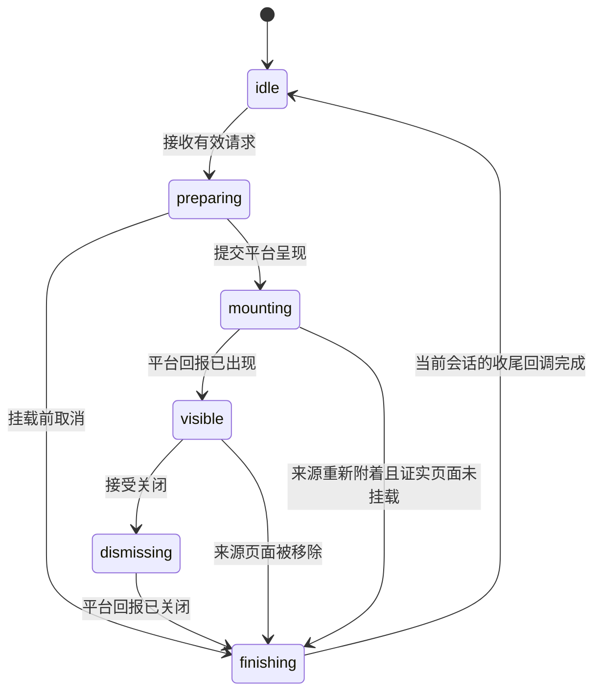

# 作者浏览、收藏刷新与页面交接

## 从时间线点进作者

点击作者时，入口保存原页面的返回上下文，并用当前账号、作者、媒体类型和屏蔽条件准备第一页。CreatorView 校验准备结果与目标是否匹配；匹配时直接使用已有 FeedStore 和读取任务。快速返回或改换账号后，过期请求的完成回调不能推进新的页面。

作者浏览区 CreatorBrowser 持有已经挂载的栏位。首次进入只建立当前参与展示的栏位。手指横拖时，目标栏参与布局；松手取消后恢复原栏，已经访问的栏保留到浏览区离开。CreatorView 持有筛选、两份 FeedStore、各自的滚动锚点和收藏编辑意图。网格继续使用作品 ID 标识卡片。具体实现见[作者页](../CivitViewer/Features/Authors/CreatorView.swift)和[第一页准备](../CivitViewer/Features/Authors/CreatorFeedPreparation.swift)。

一个作者浏览区对应一个固定的视图类型。图片和视频共用 creatorMediaPane 工厂，返回的视图在栏位边界包装为 AnyView，作品行仍使用原有具体类型。整页呈现接口继续接收具体的目标视图，在交给 PinnedPageCover 的闭包内包装业务内容，使通用呈现组件只需按业务项目类型实例化。两处转换都位于粗粒度的页面边界。把转换扩散到高频更新的每张卡片，会改变需要重新评估的范围。

## 收藏页的等待与刷新

| 当前可用结果 | 正在发生的操作 | 用户看到的内容 |
| --- | --- | --- |
| 新范围还没有结果或预览 | 第一次读取 | 保留首次加载反馈；等待读取后才能判断结果为空 |
| 有可用的缓存或本地预览 | 核对云端列表 | 先展示现有卡片；本地可用作品可直接打开 |
| 当前范围已有卡片 | 后台刷新或自动续页 | 卡片继续可用；刷新提交后更新列表 |
| 同一范围已确认到底且没有作品 | 后台重新读取这一范围 | 保持已确认的空态，即使请求超过延迟转圈阈值也保持稳定 |
| 读取失败或稍后可重试 | FeedStore 处理失败 | 继续沿用原有失败、冷却和重试规则 |

判断范围时使用账号、收藏夹来源和媒体筛选组成的请求键。已确认空态的展示判断集中在 CollectionWorksView 的 `visibleContinuation(of:for:)`，底层请求仍真实处于加载中。作品上的离线角标来自本地下载状态。这样，列表刷新、单个文件下载和整页导航可以分别验证。[收藏列表](../CivitViewer/Features/Collections/CollectionsView.swift) · [分页与刷新](../CivitViewer/Feed/FeedStore.swift)

## 整页弹出的生命周期

下图对应 PinnedPageCover 使用的 PresentationLifecycle。从时间线点作者时，作者主页通过 navigationDestination 推入。在作者页打开作品使用 MediaCover，打开收藏编辑器使用 businessPage，两者都经过 pagePresentation。

每次呈现生成独立的会话标识。在 mounting 期间收到关闭请求时，先记下意图，等平台回报已出现再关闭。来源移除时可以先结束本地会话，已挂载页面的关闭回执保留到平台确认关闭。导航提交结果和视觉清理各有回执，晚到的旧回执只能结束原会话。普通返回、手势取消、切换底栏和前后台切换必须能释放本次操作占用的输入资源。顶栏与底栏悬浮在正文之上，颜色、控件就绪和页面移动分别由对应组件处理。[呈现适配器](../CivitViewer/Navigation/BusinessPagePresentation.swift) · [状态机与回执](../CivitViewer/Navigation/PresentationLifecycle.swift) · [交互返回](../CivitViewer/Navigation/PageEdgeReturn.swift)

## Build 197 的性能取舍

首张卡片占位、首张可显示的封面和触摸能否及时响应，是三个不同的时刻。196 的一次 300 条本地夹具采样中，主线程 199 个样本里有 97 个在前 12 层栈帧出现 Swift 类型元数据或协议符合性检查。这个结果支持缩小首次建立页面时的类型组合，网络预载额度维持原值。

197 将类型擦除收在作者媒体栏工厂和整页呈现内容工厂。作品 ID、滚动锚点和手势所有者继续由原组件持有。另一个候选版本尝试按条件移除 ScrollViewReader，20 条夹具的首次封面为 420.4 ms，时间线位置测试也在初始夹具计数断言处失败。最终构建保留 ScrollViewReader。

| 首次进入作者页 | 首张本地封面，196 → 197 | 最长显示回调间隔，196 → 197 |
| --- | --- | --- |
| 首屏 20 条 | 371.4 → 338.9 ms | 202.0 → 218.2 ms |
| 首屏 300 条 | 453.3 → 396.3 ms | 315.6 → 238.3 ms |

以上是优化配置的模拟器在每次启动后首次进入的观测。20 条场景中封面更早出现，但最长回调间隔增加了 16.2 ms。第二组 196 复测与签名构建同时运行，因此未用来估算改进幅度。若继续优化滑动，应用相同数据量和缓存条件采集多轮帧时间，并在请求未完成时实际返回、取消拖动和连续切栏。

## 可复现的检查

从仓库根目录调用 `scripts/run-resume-prompt-uitests.sh <模拟器UDID> <测试方法名>`。性能对照使用相同的优化设置、模拟器和静音夹具；每页 20 条用来观察日常进入，300 条单独作为压力场景。显示回调间隔含调度影响，设备帧率需要在真机另测。

| 风险 | 仓库内的 UI 测试 | 验证时机 |
| --- | --- | --- |
| 刷新时覆盖可用内容或闪现转圈 | `testFavoritesRestoreCachedListBeforeFreshAccountResponse` | 扣住响应，检查首次读取未返回、已有卡片和已确认空三种情况，再释放响应 |
| 加载尚未完成时无法离开 | `testAuthorPendingPaginationButtonAndEdgeReturnRemainOperable` | 作者页正在补页时分别点返回、做边缘返回 |
| 访问另一栏后返回错误 | `testCenterSegmentsAndAuthorEdgeReturn162` | 切换图片／视频后，从页面边缘返回 |
| 底栏已经选中却吞下一次点击 | `testCommittedSearchAcceptsNextFooterTapBeforeHeaderAcknowledgement` | 故意延长顶栏交接，按真实屏幕坐标点下一项 |
| 整页弹出后出现重复底栏或无法退出 | `testBusinessFavoritePageHasOneTabBarAndUnwindsNestedPlayback` | 在普通、嵌套播放路径比较可见栏的左右边界，并实际切到搜索 |

完整用例见[UI 测试](../UITests/ResumePromptUITests.swift)。验证底栏对齐时，透明的辅助功能容器可以覆盖整屏宽度。应比较四个可点击按钮的横向并集加面板内部边距，与顶栏可见边界的位置。
