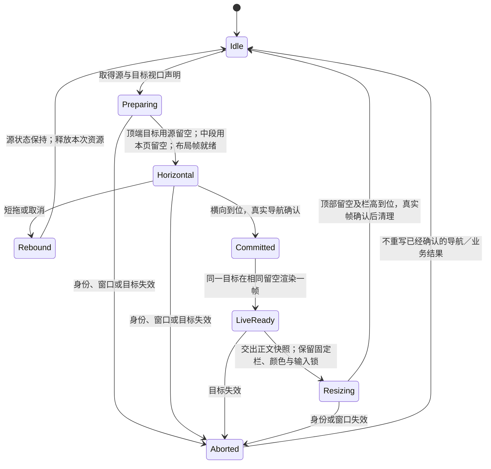

# 166 正文让位与页面状态

用户澄清：参考 ExHViewer 的是正文给单／双行顶栏让位，不是把整条顶栏移动。页面状态先保本次 App 会话，重启恢复不在范围内。此文补充 v2 的正文布局策略，不改三 App 的 token 或业务提交边界。

## 独立的两项决定

固定栏始终按结构变化伸缩，正文是否让位取决于目标视口。目标处于顶部时，横向准备与归位先使用来源留空，到位后同一个真实页面沿既有 HeaderHandoff 时钟调整到目标留空。目标已经滚到中段时，始终保留自己的留空、作品和行内偏移，不再纵向移动；栏仍正常伸缩。依据为 ExHViewer 当前 chrome-state-map 140／141／143 与 FloatingFeedLayout 的实现。

不让旧正文快照纵向平移或拉伸来模拟让位：收缩时截图底部没有足够画面，拉伸又会缩放文字和作品。正文先原子交给同一个真实 pane，已有 session 继续持有固定栏、tone 和输入 lease；最终再释放。没有新建全局转场 manager。

## 页面状态

根四页保留各自导航栈。页面／分栏保留查询、已提交结果、筛选、排序、分栏和视口；新提交／主动改条件明确重置受影响的位置。账号／站点身份变化不能沿用旧结果。菜单、键盘、拖动、确认弹窗和正在执行的云端动作不恢复。

搜索是确定缺口：作品／作者分支销毁时会重载并丢失位置。实现采用两套稳定 pane，父页持有各自 store 和锚点，切回不重发同一查询；只有 active 模式与 active 根页能自动加载或提交结果相关业务。稳定滚动宿主保留行内位置，隐藏 pane 不发布顶栏视口状态。显式新作品提交按既有语义刷新，临时模式切换不刷新。收藏已有 per-kind 锚点作为作者作品网格的范例。改变 header 高度不能用新的 .id 重建列表。

让位计划还绑定 FloatingPageBar 的稳定 contentOwner UUID，而非只绑定主 tab；被覆盖的旧路由不消费进入页的临时留空。缺失目标 header、render 失败或未到目标高度必须 visual aborted，不能一边记成功一边清计划导致内容跳到终值。导航已提交的结果保持不变。

## 有限验收

四格分别录制：顶端单→双、顶端双→单、中段单→双、中段双→单。顶部首项应随下沿连续让位，不缩放；中段作品与行内偏移不变，栏有伸缩中间帧；两者底栏坐标不变。再覆盖短拖取消、反向、后台／旋转、目标失效和输入锁清理。快照存在不代替像素验证。

搜索状态测试覆盖：作品搜索滚动→作者搜索滚动→作品／作者往返→作者子页返回→切主 Tab 再回。结果不重载，回到原锚点；新查询回顶。数据缓存、页面保留和运行中的精确滚动恢复分别验证。

性能基线165：1000作者榜→搜索，三轮 UI 用例通过；18次顶栏 raster 中位约3.43ms，首次179.25ms，其他最大5.48ms。三轮1.74–2.00s包含XCTest截图与层级查询，不能当成纯转场耗时或真机帧率。冷渲染与转场的串行等待需分别测量后再选修复。
