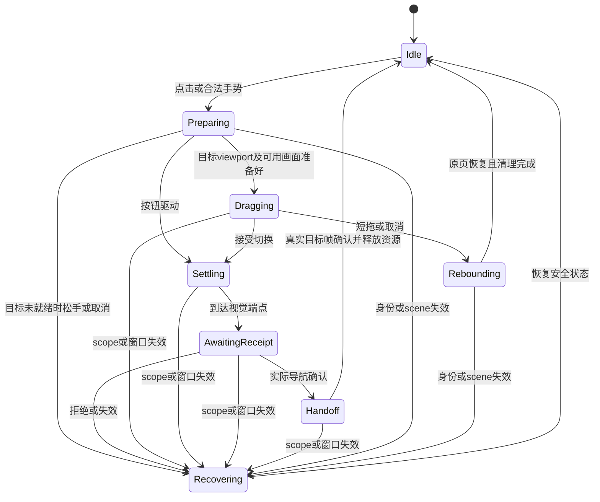

# CivitViewer 导航、动作与界面方案 v2（设计稿）

日期：2026-11-12。状态：继续设计，未恢复新转场实现、未安装或发布。手机已核对功能基线为 1.1.0 (164)；当前下载管理、屏蔽作者样式改动有各自定向回归，不等于整批改动已验收。

本文集中表达本会话最新用户规则，供架构和界面评审。`page-motion.md` 的早期边缘切栏表及根页不切换的规则已被用户后续决定替代；其中构建和回归记录仍是对应历史产物的证据。本文的拟议架构、时序和迁移步骤不冒充已实施。

## 页面角色与手势

| 角色 | 实际页面 | 边缘内划 | 中间横滑 | 退出与数据 |
| --- | --- | --- | --- | --- |
| 时间线根页 | 关注／推荐 × 图片／视频 | 保留起手上下区域规则 | 保留媒体原手势 | 不改变既有语义 |
| 其他根页 | 作者榜、搜索、收藏 | 按显示顺序循环切相邻主页面 | 作者榜／收藏切本页分栏；搜索保留输入和结果交互 | 短拖不改当前主页面 |
| 浏览子页 | 作者主页、关注、历史、下载管理、作品详情、播放 | 两侧向内滑回上一层 | 作者页图片／视频；历史等既有浏览分栏可在中央切换 | 无隐式远端写入 |
| 本地配置／选择 | 条件、标签、作者选择、已存条件、侧栏、下载设置 | 两侧返回，不因有选择器改成切栏 | 选择器按明确点击动作修改本地草稿 | 成功返回才应用需提交的草稿；回弹不应用；现有即时设置保持其已确认语义 |
| 云端编辑 | 收藏夹编辑、账号内容偏好 | 两侧请求退出 | 不与页面返回抢手势 | 只有确认按钮写云端；返回不隐式保存 |
| 菜单与确认浮层 | 统一自绘选择器、长按菜单、确认 | 打开期间拦截背景页面手势 | 保留浮层内部滚动 | 关闭只结束浮层 |
| 系统流程 | 分享、授权浏览器、键盘 | 系统负责 | 系统负责 | 不用自绘横滑替代系统生命周期 |

底栏真实顺序为 `[0, 2, 4, 3]`：时间线、作者榜、搜索、收藏。右边缘向左内划去后一项，左边缘向右内划去前一项，首尾循环。时间线起手仍只执行自己的既定手势；从其他根页可以切入时间线。进入子页后优先返回上一层，不越过子页切主页面。

手势按起手位置与页面角色锁定一次：浮层／系统 > 当前转场的输入锁 > 子页边缘返回 > 非时间线根页边缘切主页面 > 中央分栏 > 内容滚动与点击。横竖意图未成立前不抢纵向滚动，成立后不在途中改动作。输入框编辑／系统交互有明确优先级，不靠注册顺序碰运气。

## 可见界面模板

1. **根浏览页**：顶栏和底栏位置固定；只有正文参与横滑。底栏选中在切换确认后更新，拖动取消不改变当前项。拖后残余点击不得打开作者／作品。
2. **作者主页**：顶栏返回／图片视频分段／更多；身份卡与状态卡使用标准间距。屏蔽态顶栏中间为“作者”，正文保留身份卡，下一张短提示“已屏蔽此作者／可在设置中管理屏蔽作者。”解除只在设置中提供，不展示作品。
3. **搜索**：作品和作者是独立模式；作品条件里仍可限定作者。结果在当前页正文显示。作者页进入搜索复用作品模式并预填作者。同一条搜索状态不复制成第二份 DraftStore。模式变化改变顶栏声明，输入文本／下载进度等内容变化不重播顶栏。
4. **我的关注**：顶栏只写“我的关注”，排序在栏内，人数放列表底部。无缓存时只有内容区居中加载动画；有缓存立即展示，后台更新保留列表，失败不清掉可信缓存。缓存必须绑定账号、成员集合与顺序修订；具体实现仍待开发。
5. **下载管理**：共用两排顶栏：第一排返回／下载管理／更多；第二排任务／空间。任务只列下载中、等待、暂停、失败；已完成任务从任务区移走；收藏中已就绪作品不显示角标，只有下载中／等待／暂停／失败显示必要角标。空间只列占用／上限和清理，不重复作品列表。更多中放检查待下载收藏、下载设置。进行中的下载禁用不安全的清理动作，并说明状态，不靠图标猜测。
6. **屏蔽列表**：编号圆角矩形／头像／作者名／移除。序号四位数占宽、自然数字居中、不补零；长名尾截断，右侧操作不能被挤走。作者 ID 不做默认第二行。
7. **设置子页**：一套标题、左右操作目标、设置卡与说明文字层级。右上只放有明确含义的操作；恢复默认仅在支持本地恢复的页面显示，已是默认时禁用，不为补对称放无意义按钮。
8. **历史／诊断／标签库／开源组件**：使用上述浏览或配置模板。历史长按进入多选，操作为收藏和删除记录；诊断导出／清空进更多；标签库同步状态以用户能采取行动的短文案表示；开源组件先目录、再协议内容，避免所有长文本挤在一个入口。

## 正文、固定栏与内部布局

普通子页、业务整页、详情，以及作者／收藏／搜索／历史／本地缓存入口的播放，全部复用 Shell 的唯一底栏宿主，不在新页面创建第二份或漏掉底栏。纯净播放按用户操作隐藏是显式例外；系统分享／授权浏览器使用系统界面。底栏可见与是否允许交互分开，登录或保存中的禁用由明确业务策略决定。正文clearance、点击屏蔽和底栏可见性使用同一实际宿主几何。

页面进入与退出优先采用横滑。左上返回统一向右退出；从右边缘向左内划返回时正文沿手指向左退出，左边缘则向右退出。系统模态交互不强制改为横滑。全屏播放与详情保留同一业务来源身份，不能为了动画新建第二份可交互页面。

顶栏外框上沿固定，底栏位置固定；几何与控件替换分开，任何阶段都不把整个顶栏一起透明。普通内部展开只改变受影响容器高度和裁切，不对整个页面播放进出场动画；文字与图标不缩放。

| 顶栏变化 | 视觉顺序 |
| --- | --- |
| 单行→单行 | 外框常驻，只替换变化的内容或调整内部位置 |
| 单行→双行 | 先展开下沿，新增排在裁切内展开，再完成第一排淡换 |
| 双行→单行 | 下排在收缩中退出裁切，下沿收回，再淡换第一排 |
| 双行→双行 | 保留未变化排，只有变化排替换；内部宽度按实际测量调整 |
| 连续反向 | 从当前呈现几何和颜色接续；旧回调不能复位新目标 |

拟以现有 180ms 下沿伸缩、140ms 内容替换、300ms 色调作为首轮比较起点，不作为全路径永久硬值。正文松手收尾以当前已用的有限 260ms 时序为比较起点，依据剩余距离调整。Reduce Motion 跳过位移但不跳过提交和清理契约。顶栏、底栏、安全区和正文背景读取同一个外观进度，不能在各层新建黑白渐变。

源正文使用源页最终 clearance，目标正文使用目标页最终 clearance，从准备起保持稳定布局。固定栏伸缩改变裁切和背景补齐，不在目标滑到位后再改变正文位置。拖动期保持源顶栏结构，颜色可跟随进度；接受切换后再执行目标的 resize→replace。回弹时不挂卸新控件、不丢焦点。

## 动作与实际呈现的契约

必须区分 NavigationIntent、NavigationOutcome、VisualOutcome 和业务结果。可以用有类型的小结构表达，不要求新建全局大类或每页多层架构。一次动作只有一个 session owner，Header／Body 是参与者；输入锁覆盖拖动、收尾、平台确认和真实帧交接。

Recovering 仅恢复本次视觉和输入资源；若导航已产生 committed receipt，随后视觉中止只能报告 VisualOutcome.aborted，不得再把既有 NavigationOutcome 改成 cancelled，也不重复提交业务。

这是对外结果契约，不强迫所有平台 adapter 在同一毫秒调用导航 API。UIKit 可以先挂载／进入交互，只有成功 receipt 才算确认；业务不能从预览挂载、viewDidDisappear 或任意 animation completion 推导保存成功。

目标准备好不等于网络全部完成：布局稳定、可用缓存或正确占位已渲染即可。预加载仅允许有界读取，不能结束源播放器、记浏览历史、打开菜单桥、写云端或应用草稿。准备阶段松手／反向必须有明确取消结果，不把不可用目标突然跳出来。目标与用户身份失效、旋转、后台都要结束本次 token；取消视觉不回滚已经确认的独立云端成功结果。

每个异步结果同时核对 route instance／账号与站点 scope／request 或 attempt。Task取消是协作式；取消后返回的结果仍要核验身份。共享下载和缓存任务归 Service，不随一个页面销毁直接终止。

## 现有代码的调整范围

| 现有部分 | 保留职责 | 迁移后应删除或收缩 |
| --- | --- | --- |
| PresentationLifecycle | 实际cover session、mount/dismiss及幂等 | 不承担业务保存或视觉成功判定 |
| PageReturnCommit | native pop成功receipt，兼容本地草稿 | 查询edge视觉completion、为纯视觉收尾普遍挂no-op commit |
| BusinessPagePresentation / PinnedPageCover | 业务呈现意图／实际平台适配，分别命名 | 相互复制opening/active及控制器树查视觉闭包 |
| TabPageMotion | 主页面选择适配 | 不能再分别建立按钮与edge两套完整生命周期 |
| PageEdgeReturn | 子页手势与平台返回适配 | 成功后默认再播放一段正文淡换；不能直接写草稿 |
| SegmentedPageMotion | 稳定pane与进度、循环边界 | 另藏一份可提交的业务selection或独立成功规则 |
| TimelinePageMotion | 特有source/kind与媒体预热 | 不加入根边缘切Tab；保留poster到live必要交接但不能二次位移 |
| NativeHeaderMotion / HeaderHandoff | 固定栏视觉适配／渲染 | 超时不能报告导航成功，不自己拥有业务路由 |
| PageBodyHandoff | 正文画面与真实帧交接 | 显式completed/cancelled/aborted，不能无结果completion都当成功 |

根容器先验证现有TabView adapter。临时选中目标Tab会改变真实appearance，不能只因代理selectedTab未改变就认为预览无副作用。若取消不保源状态，则仅调整外层为稳定key的受控host，保留四套NavigationStack与业务owner；active/preview/inactive分明，按需准备相邻目标，不默认常驻四个活跃播放器。

## 设计token与三App共享边界

共用schema、角色名、单位与验收语义，每App一套取值。Civit候选快照见 `design-tokens.proposal.json`，当前生产来源仍为AppTheme/FloatingPageChrome/ContentMetrics/AppTypography；未建立第二套运行时真相。未来选择单一可编辑源并生成Swift/CSS常量，迁移须核对生成结果和最终画面，不能长期双向手抄。

需要区分targetSize、outerVisibleSize、nestedVisibleSize、gap、contentInset、viewportClearance和safeAreaPolicy；4pt同排间距不等于所有可见描边间隙都4pt。字体用语义角色和动态字号策略，状态色用语义palette，不能把三App硬改成相同数值。动效值按角色配置，结构identity排除输入值、计时和下载速度。

Swift两App可先共用纯状态转换测试、结果值类型、几何/进度计算和token生成验证。实现确有两个消费者且接口稳定后才抽包；UIKit层、导航容器、菜单控件先各自适配。HG采用同语义TS/DOM实现，不建跨语言运行库。

保留业务差异：Civit本地筛选成功返回才应用、云端明确确认、收藏自动下载；ExH边缘返回执行有效搜索而点击返回仅退出、无效条件回弹、Reader与站点收藏原序；HG切集／本地优先／来源attempt／播放进度与历史、原生资源会话。不能统一成通用Bool返回或把所有收藏当成同一协议。

## 分步迁移与验收

1. 固化角色和typed outcome；保持现有画面。替换完成闭包交叉查询，区分超时中止和实际receipt。本地draft消费receipt，云端保存消费明确业务结果。
2. 一次session组合header/body/tone/input lease；先按钮，再既有edge返回。保留已验证geometry，删重复收尾后再继续。
3. 做非时间线根页的长拖／短拖pilot：验证host预览无副作用、循环方向、稳定目标和颜色进度。通过后再扩按钮、cover和全部模板。
4. 按页面清单逐条接入，删除旧分支；最后才移动文件。不能用拆文件或代码行数下降作为优化证据。

每条回归分别记录导航提交次数、业务提交次数、视觉终止结果。覆盖冷／热目标、失败、快切、反向、短拖、长拖、松手后点击、键盘、辅助字号、横屏、后台、账号变化、目标失效。要求取消时该token／该动作不产生新增业务提交（不撤销此前独立确认的即时设置或云端成功）、成功至多一次对应提交，锁和视觉资源归零、固定栏坐标不变、目标无额外位移、源滚动与媒体身份在回弹后保持。资源规模另测：10次往返最多4个根host，一个活跃播放器；预热和缓存以明确预算验证，不从静态代码推断“不卡”。

当前UI定向通过：下载任务／空间切换与设置进入返回；屏蔽作者序号列表添加移除；屏蔽后作者主页提示及无解除入口。更广历史用例有独立失败记录（历史开关定位、收藏播放底栏标识），未用这些定向通过覆盖。新转场架构尚未实现或运行验收。
