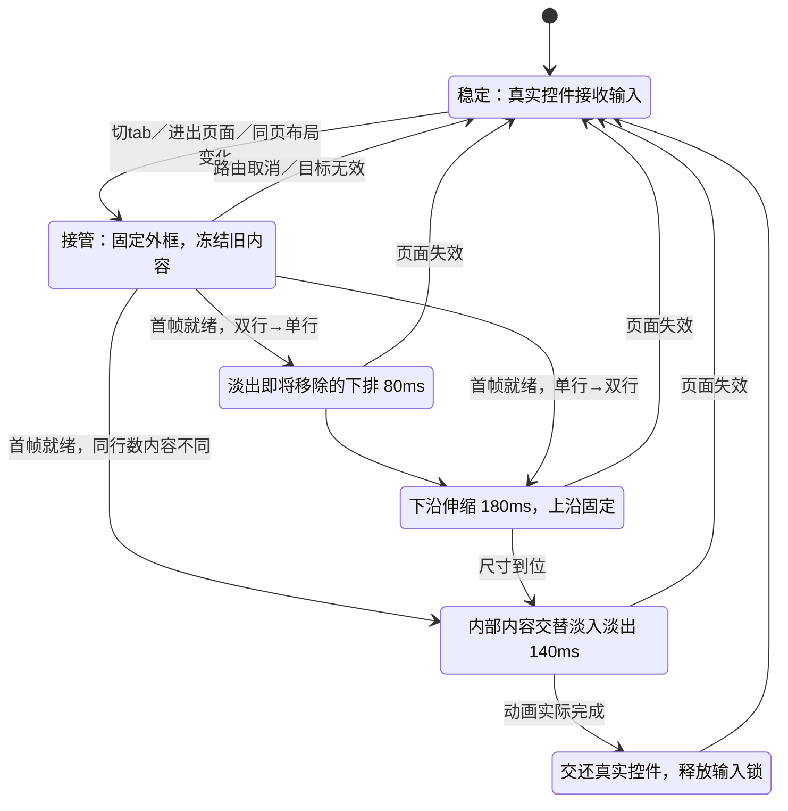
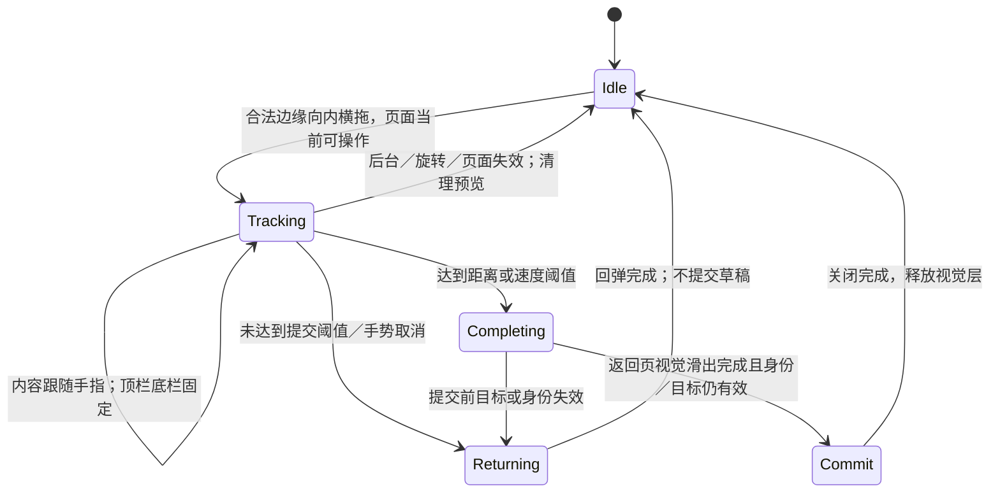
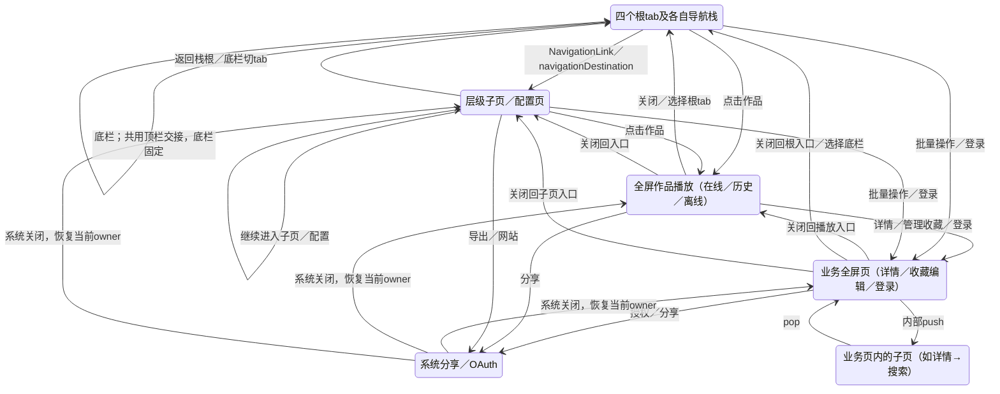
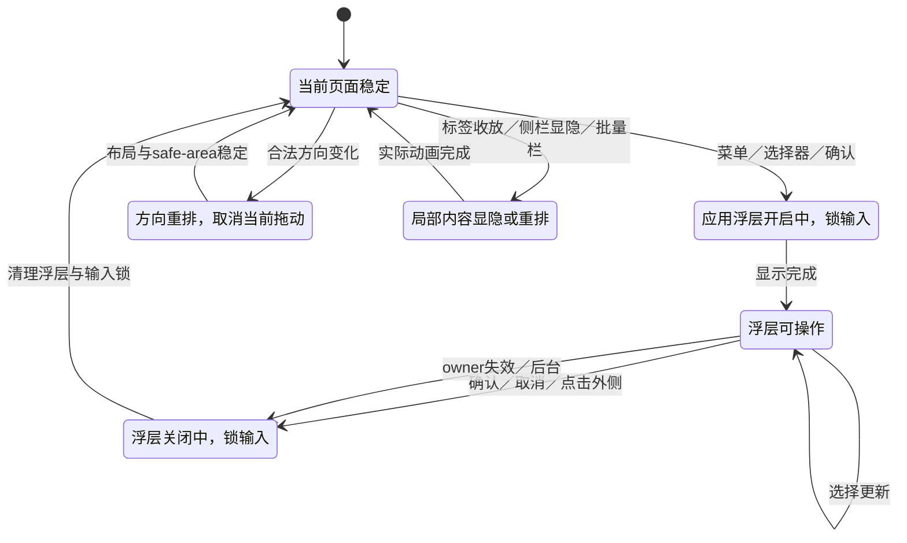
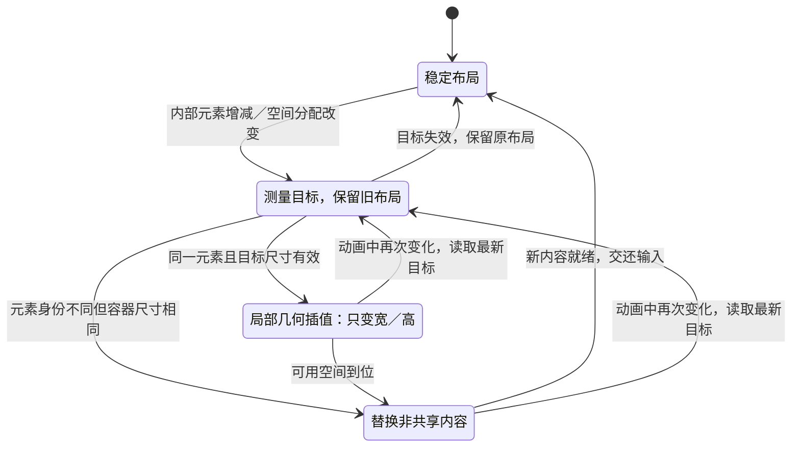
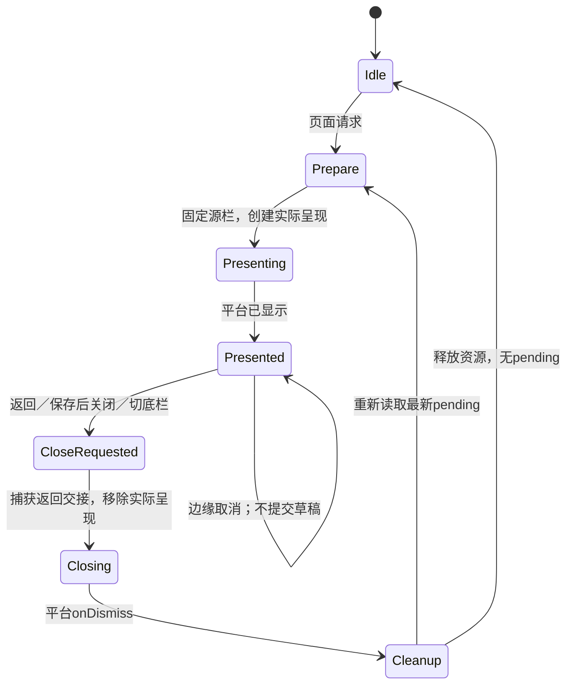
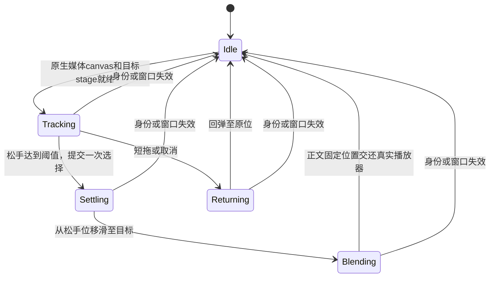
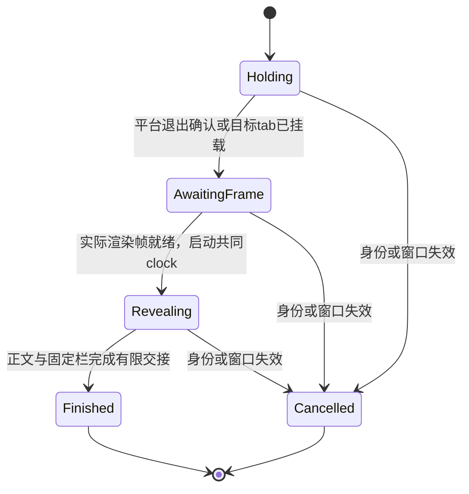
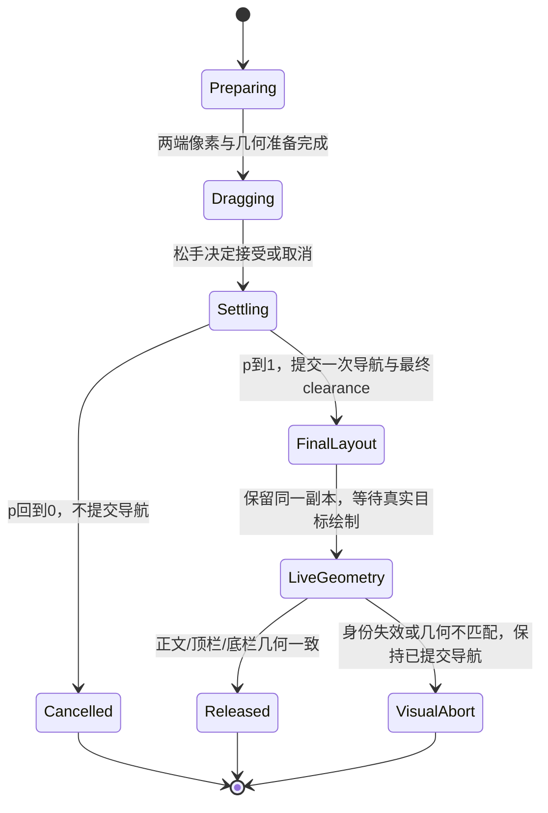

> 最新方案入口：[导航、动作与界面方案 v2](navigation-design-v2.md)，正文让位与会话内页面状态由 [166 补充方案](content-clearance-166.md) 更新。165 核心迁移见 [165 重构记录](verification/refactor-165.md)，166 验收见 [166 记录](verification/refactor-166.md)。下文保留历史实现与回归记录；早期“浏览页边缘切栏／根页不切换”已被用户后续的“中央切栏、子页边缘返回、非时间线根页边缘切主页面”决定替代。历史通过不能代替当前候选的运行验收。

# 页面与控件动效

本次设计以实际页面角色为依据，不以是否含 Picker 判断浏览性质。页面位置和视觉所有权分开：顶栏上沿、左右外沿及底栏位置固定，内容区可以平移；只有顶栏下沿可以因行数变化伸缩。字号、图标和圆角不做比例缩放。

## 顶栏状态图

- 首帧：复用 `RenderFrameBoundary` 等待新旧行图层实际挂载，再启动 opacity 动画，防止新图层直接出生在终值而没有过渡。
- 展开：旧首排保持，外框先向下展开，再交替淡换首排并淡入新增排。新增排不能在容器未展开时先露出。
- 收起：下排先淡出，外框下沿再上收，最后淡换首排。
- 同行数：外框不动，仅内部内容交替淡换。首排中按钮尺寸固定，中间轨道分配剩余宽度；文字只排版或截断，不缩放。
- 色调：表面与底栏按共用 300ms 曲线混色，和几何动画并行。任何步骤都不淡出整条顶栏外框。
- 操作锁定：转场期间拦截新的点击；取消、退出和完成必须释放锁；边缘手势已处理后台打断，顶栏已增加所属 scene 失活清理与可取消等待，后台中间态仍需单独运行验收。降低动态效果时由现有调用端跳过几何过渡。
- 同页布局发生反转时完成当前视觉阶段，读取最新目标尺寸再收敛；不交还旧尺寸的真实控件。

## 边缘交互状态图

| 页面性质 | 左右边缘 | 返回时的数据行为 |
|---|---|---|
| 有切栏的浏览页 | 双侧切栏，首尾循环 | 不隐式返回；多选或忙碌时禁用切栏也不改成返回 |
| 无切栏的浏览子页 | 双侧跟手返回 | 无写入 |
| 本地配置／标签／作者选择 | 双侧跟手返回，分段控件仅点击 | 成功返回才应用草稿；回弹不应用 |
| 云端收藏编辑／账号内容偏好 | 双侧返回 | 返回取消；确认按钮才写云端 |
| 根tab | 无上一级时不返回 | 底栏负责切tab |
| 主时间线 | 保留既定上下半区域切换规则 | 上半关注／推荐，下半图片／视频 |

分栏与返回的数据提交时点不同：分栏在松手接受切换时更新 selection，再等待新 pane 首帧补完滑动；返回页先完成视觉滑出再 dismiss；本地草稿在实际 pop 确认后才应用。这些时点均须防止动画期间二次点击。

## 浮层与内容变化

菜单、选择器与确认浮层使用 AppMenus 的共用开关状态和输入锁，不移动背景顶栏／底栏。系统分享、系统授权浏览器继续由系统管理。作品内容滑动、标签列表加载和键盘布局不触发顶栏整体淡出。标签的增加／移除只影响其内容容器，不能把顶栏或底栏整体推走。

顶栏转场只渲染静态控件图像，外框单独伸缩与混色，不挂载第二套可交互控件。返回预览使用此前页面在可见时缓存的视图快照，真实页面不改变层级；最多保留三个页面的预览，并绑定账号身份。浏览分栏仍保留两套真实内容 pane 跟手，不用返回预览代替分栏内容。

本文件记录设计与实现契约；页面清单和运行回归证据须分别核实，不能用状态图代替实际路径测试。

## 模板覆盖清单（生产源码盘点，158）

| 模板 | 覆盖页面／状态 | 转场所有者 |
|---|---|---|
| 根tab | 时间线、作者榜、搜索、收藏 | TabPageMotion + HeaderHandoff |
| 同页顶栏布局 | 搜索作品双行↔作者单行；同尺寸条件／选择态 | 高度／显式结构身份变化由 NativeHeaderMotion + HeaderHandoff；输入值由原控件更新 |
| 层级浏览 | 作者作品、我的关注、最近浏览、离线空间、下载管理 | NavigationStack + NativeHeaderProbe；边缘由页面角色决定 |
| 层级配置 | 账号与设置、账号偏好、下载设置、播放侧栏、浏览条件／收藏筛选、屏蔽标签／作者、本地标签库、诊断、开源组件 | NavigationStack + NativeHeaderProbe + PageEdgeReturn |
| 本地编辑 | 选择标签、选择作者、已存条件、保存／重命名条件 | 同上；Filter／Tag／Author 的成功 pop 触发本地草稿提交 |
| 业务全屏页 | 作品详情、单作品收藏夹编辑、批量收藏／移除、登录／收藏授权 | pinnedPageCover + NativeHeaderRoute；业务闭包负责关闭和云端确认 |
| 作品全屏播放 | 作者／搜索／收藏／时间线网格播放、历史恢复播放、离线播放 | mediaCover + 共用 MediaDeck / FeedMediaViewer；统一 PinnedPageCover；进入与退出均不使用系统上下滑动 |
| 浏览切栏 | 作者榜、作者作品、收藏、历史、离线 | SegmentedPageMotion：点击、跟手、提交、回弹、循环 |
| 特殊时间线 | 关注／推荐×图片／视频；流式／网格 | TimelineEdgeMotion，保留起手位置分区 |
| 内容可见性 | 图片／视频侧栏、进度条、播放按钮、纯净模式、恢复提示、失败／预备提示、详情标签收放、批量操作底栏 | 各内容 owner；不改变公共栏的位置 |
| 应用浮层 | 单选、多选、菜单、长按菜单、确认、全局消息 | AppMenus / AnchoredChoicePresentation |
| 系统浮层 | 分享、OAuth浏览器、键盘 | iOS 系统管理；不得复刻系统授权和分享 |
| 方向变化 | 竖→横、横→竖、系统方向、手动方向、刘海安全区 | ViewingOrientation + UIWindowScene；与路由转场独立 |

### 页面路由状态图

图中“返回入口”只返回真实 presenting/navigation owner，不创造另一条路由。业务全屏页与网格进作品均由 PinnedPageCover 管理实际呈现，禁止 UIKit 整体上下滑动；公共顶栏和底栏不随正文移动。

### 浮层／方向／内容变化状态图

### 不变量与测试矩阵

- 主栏：每次过渡比较顶栏 minY / minX / maxX 以及底栏整个 frame；只允许顶栏 height 改变。
- 行数：单→双、双→单、同高→同高；同色与黑白跨色两组；快速反向和返回入口两组。
- 手势：左／右，短拖取消／长拖完成；循环首尾；多选／保存／弹层期间拒绝新手势；操作结束没有残留点击锁。
- 配置：本地草稿实际 pop 后提交，push另页／覆盖／取消拖动不提交；云端写入仅明确确认。
- 全屏页：原入口关闭、进入内部子页再返回、切底栏、账号变化、系统分享结束。
- 方向：竖屏、横屏、变化中打断拖动；缺少几何锚点时清理并交还真实页面，不继续使用旧坐标。
- 可访问性：大字号与长文本保持按钮命中区，降低动态效果不做不必要平移；系统分享和OAuth沿用系统边界。

源码清单证明模板已盘点，不代表上述矩阵全部取得运行证据。每次回归保存源文件清单和测试结果，未运行项明确标记，禁止以“审过”替代“实测通过”。

## 内部空间变化：尺寸与内容分别交接

内部变化分为四种，不对整条顶栏做 scale，也不改变顶栏和底栏的锚点。

| 变化 | 几何处理 | 内容处理 | 约束 |
|---|---|---|---|
| 单行↔双行 | 外框仅改变下沿，按前述阶段执行 | 首排淡换，下排延后显示／提前隐藏 | 禁止先挤扁下排再缩框 |
| 同高度、不同页面 | 外框与按钮尺寸固定 | 旧内容与新内容交替淡换 | 不平移整条栏，不整体变透明 |
| 同页中间区域宽度变化 | 左右固定按钮保留尺寸，剩余宽度重新分配 | 同一元素优先保留身份；新增／移除内容交接 | 文本截断，不拉伸字形；不为短文案缩小命中区 |
| 内容卡片／标签收放 | 只改变局部容器下沿及后续内容位置 | 新内容在可用区域内出现 | 不将公共栏推出屏幕，不做整页弹跳 |

第三种不能靠缩放冻结图片伪造。当前跨页面采用稳定外框＋内容淡换；只有明确共享身份的局部控件才允许插值宽度。没有共享身份的两个控件不强行做形变。以上是尺寸变化的设计规则，具体局部消费者必须按实现与实测证据分别验收。

### 覆盖判定

“所有界面”按上述生产模板清单逐个登记，并交叉检查进入、返回、底栏切换、局部变化、弹层、横竖屏。加载中、空、失败、无权限、多选、键盘、长文本属于模板状态，不另造一套尺寸与转场。静态路由盘点、自动回归、人工观察与真机验收分别记录；任何未执行状态均不能写成通过。

### 显式结构身份与取消契约

同页使用 `layoutIdentity` 声明结构变化：搜索模式、作者屏蔽状态、历史／离线的多选状态、收藏文件夹选择器有无、设置账号操作有无、批量编辑完成状态。它不包含搜索字串、用户名、标签数量、下载进度或当前图片／视频分栏值，避免输入过程中反复冻结顶栏，也避免和分栏动画争抢所有权。当前同高度结构替换采用内容淡换；不将其描述为槽位的真实几何形变。

返回按钮由页面模板显式放置；native 探针仅仲裁手势资格，不再通过异步回流决定按钮是否存在。

后台取消的顺序：失效当前 flight → 取消帧边界与动画等待（每个 continuation 只恢复一次）→ 释放过渡层与 lease → 恢复真实控件。所属 scene 非 active 期间拒绝重新 pin。已选 tab／已完成导航不会回滚；本地草稿仍以实际 pop 为提交边界。

## 158 验证记录（2026-11-12）

- 动效运行回归：6/6 通过，`build/subpages158-final-motion.log`，源清单 `f032885d09c53a5e6cc1335c8a257c1dd272fe2e7f176d43c273fb0e95e86de1` 前后相同。覆盖左右边缘本地配置返回／取消／实际草稿生效、详情双边返回、作者榜与收藏完成滑出／取消回弹、播放后台恢复、单双栏真实中间帧／顺序／点击屏蔽、快速反向布局。
- 配置页可访问性：List 的 AX frame 与顶栏重叠，XCTest 的 `isHittable` 会误报。保留诊断附件，同时用真实屏幕坐标触摸返回，并核验返回入口、重新打开和草稿值；不以放宽 predicate 代替行为验收。
- 视频返回预览：合成视频录屏 `build/subpages158-video-return.mp4` 中间拖动可见缓存视频画面，公共栏固定；该检查未使用真实账号媒体。
- 离线下载诊断：最终 72 条本地断言通过，1,000 条事件代表样本为 191,502 bytes。兼容旧 JSON，有限错误上下文，取消不记失败，空间不足走队列暂停；不以本地测试证明历史真实失败原因。
- 真机只读现状：86 条离线记录均 ready，对应 86 个媒体文件存在且非空，约 9.27 GB。原失败任务身份和原始原因未取得，均为 UNKNOWN；不做真实重下或云端写入。
- 独立运行回归：第二轮横竖屏／保存条件路径通过（`build/subpages158-independent-r2.log`）。首轮保存命中转场锁、同名取消查询歧义和 reset 旧显隐断言保留原失败回执；测试改为交接后真实操作、浮层内查询、默认态禁用断言。侧栏项中断留下隐藏详情的测试偏好，已让该测试通过真实 reset 恢复自身 baseline；不使用启动偏好覆盖来规避跨重启持久性验收。第三轮侧栏持久化与菜单／多选／删除／取消全部通过（`build/subpages158-independent-r3.log`），源清单 `170485e4a59680cc8a74f495747e8a4e4d5bab5393a7be893d4f2e0c098b8d7e` 前后相同。独立三项最终闭环，轮次间仅 UITests 改动，生产文件不变。
- Phone 158：构建、签名校验、覆盖安装通过；安装后设备读回 `com.xueyj.civitviewer` 为 1.1.0 (158)。173 项目录条目数一致，86 个作品 ID 保持且全部 ready，所有原媒体／封面的大小与修改时间保持；索引扫描／核对时间刷新，标签集合语义不变。未以文件元数据比对冒充全文件哈希；未自动启动真实账号 App。回执 `build/phone158-delivery-readback.json`。

此记录的“模板清单完整”仅指生产源码声明的路由与控件类型已逐项登记。后台任意毫秒打断、全部网络返回组合、所有大字号设备等不能从有限回归推导为穷尽验证；真机触感仍由用户验收。

## 159 呈现所有权收敛（历史实现，160 已继续拆分）

- `PinnedPageCover` 唯一持有实际 opening、activeID、closing、finishing；外部 item 是请求，不等于 UIKit 已呈现。
- 真实打开前先 preparePresentation；真实移除前先 prepareDismissal；实际 onDismiss 后统一收尾，再读取回调后的最新 pending 请求。旧请求不清掉不同 ID 的新请求。
- Business、MediaDeck、MediaCover 提供业务资源／返回意图，移除其独立 actual-present／prepare 生命周期。方向恢复属于播放资源策略，云端保存仍由业务明确确认。
- 普通返回与离开到作者／底栏分别声明 dismissal policy，避免链式导航中重放中间播放页的顶栏。
- MediaCover 显式声明 ordinary 或 playback 来源；兼容播放属于媒体→媒体，不使用白色入场或普通页返程混色。普通页返程由 MainTabs 同一 canvas 与底栏事件处理。
- Header raster 使用专用 isHeaderRasterPreview；只绘制 SwiftUI 外观，跳过菜单、返回、输入和分享的 UIKit 桥。真实页面保留交互桥。
- 详情去掉单独内容 opacity 淡入，仅保留整页 canvas 混色；canvas 覆盖安全区，播放根明确画黑色。边缘拖动仍保持固定栏位，正文跟手。

动画 settled 只表示视觉结束，不表示平台已关闭或云端写入成功。三者分别验证。

### 159 运行证据与架构剩余边界

- `build/presentation159-r2-tests.log`：作者／搜索播放、兼容播放器、详情双侧返回、详情切底栏、方向锁定与系统跟随、视频详情返回共六项通过。标签新测试因常驻清空槽位的断言契约错误失败，保留原回执。后续两次断言分别校正标签按钮的禁止命中、搜索重置按钮的禁用状态；没有以删除真实输入／清空步骤规避验证。
- `build/presentation159-tags-r4-tests.log`：连续三轮 Search → Tags → Back、两处真实输入与清空通过，70.226 秒；源清单前后一致 `e2f0f899ac36f56985d94d9aa161f88c6750f58ee33a6fcacd6378e51e85b34c`。三轮采样上沿均为 70 pt，68 → 36 pt 的高度变化均记录到 7 个中间采样与 7 个点击屏蔽采样。
- r2 完整录屏 328.480 秒；独立连续帧复核作者和收藏播放无系统底部上滑，详情右上 120 个连续采样帧无黄色禁止标记。有限采样不代表所有时序穷尽验证。
- 保留的交互策略：详情边缘拖动时正文跟手、源页面的固定 chrome 保持源色，完成后恢复播放色；159 未实现固定栏背景随手势进度混色。若“白边”指未完成返回阶段的源色栏位，此边界仍存在，不以安全区修复冒充策略变更。
- 当前结构仍有三处后续收敛点：Business 层重复维护请求 staging／active identity；MediaDeck 同时协调播放与业务退出；NativeHeaderRoute 持有正文返回完成闭包。实际 UIKit 呈现入口已统一，不表示三处职责全部拆分完成。
- 下一步限于一个责任边界：请求保留在 Feature，实际 opening／closing／pending replacement 仅由呈现器管理，正文完成通知移向实际关闭生命周期。需保护旧回调不关闭新请求、手势取消不提交、资源恰好归还一次、Reduce Motion 和方向中断。业务云端确认不能由视觉 settled 推断。

- Phone 159 交付：签名验证、覆盖安装和安装后设备读回完成，版本为 1.1.0 (159)。安装前后 86 条离线记录全部 ready，ID 相同、索引字节相同，媒体与封面大小／修改时间相同，目录条目均 172；未自动启动真实账号 App。`build/phone159-delivery-readback.json` 记录边界，未发布 Git／Release。

## 160：先分清实际生命周期，再统一正文视觉

方案 B 经 HGViewer 与 ExHViewer 两个现有会话分别审阅后实施；两边只审方案，不修改本项目。职责划分如下：

| 责任 | 唯一所有者 | 不承担的责任 |
|---|---|---|
| 业务目标与确认 | Feature 的 item/requestIdentity、业务保存回调 | 不把请求非空视为平台已经显示 |
| 实际全屏呈现 | PinnedPageCover + PresentationLifecycle | 不用视觉完成推断云端保存成功 |
| 顶栏尺寸、内部替换与颜色 | NativeHeaderMotion / TabPageMotion + HeaderHandoff | 不持有正文关闭完成回调 |
| 正文进入与按钮返回 | PageBodyHandoff | 不创建路由，不修改业务数据 |
| 边缘返回的跟手与提交 | PageEdgeReturn + PageReturnCommit | 不与按钮返回叠加第二段正文淡换 |
| 内容可用范围 | PageViewportGeometry / PageBodyViewport | 不安装手势，不推断页面角色 |

PresentationLifecycle 使用 idle → preparing → mounting → visible → dismissing → finishing → idle。平台回调必须匹配本次 session UUID；业务 ID 可以不变，而重新打开的意图需要新的 requestIdentity。相同业务 ID 的内容更新不必重建整个呈现。源 owner 拆除、scene 失活、准备中取消分别处理；尚未挂载的请求不等待一个不会到来的 onDismiss。真正 onDismiss 后重新读取最新请求，旧视觉回调不能完成新会话。

HeaderHandoff 改由有限 CADisplayLink 时间线推进，结束时写入精确终值并释放等待。原先作者榜 → 搜索停在 resizing：真实目标输入框已存在，但顶栏动画完成回调没有返回，输入锁一直保留。基线主线程采样大部分在等待，不能归因于“榜单 1,000 行计算太慢”。根 tab 离开另有显式标记，只跳过已确认离开根 tab 的 disappearance 返回预览；普通 push、覆盖与未知来源继续保留原缓存契约。

正文视觉层只复制已登记的正文视窗，真实目标在下方渲染。固定顶栏和底栏不进入截图。实际目标挂载、同窗口、方向、safe-area 和 trait 有效后，等待两个显示帧，再用共用 260 ms 曲线交接。一个窗口最多一个临时正文层；没有有效几何则跳过，不猜测任意子树。后台、方向或源 owner 变化取消并释放；安全区背景按源色交接，不能用系统白底代替播放黑底。

已移除的重复淡换：详情入口、BusinessPageSurface 入口/返程、MediaDeck 返程、普通 MediaCover 入口。保留的 MainTabs canvas、HeaderHandoff 和底栏色调属于固定背景/公共栏；不再各自叠加一段正文 opacity。边缘返回完成、链式切 tab/作者等路径复用自己的已接受交接，不重播中间播放页。

### 160 已取得的证据与边界

- `scripts/verify-presentation.sh`：生产 PresentationLifecycle 的 45 条状态断言，包括旧回调、新请求、源拆除、挂载中关闭、scene 失活、恰好一次收尾。
- 基线 `leaderboard160-before-r2-tests.log` 和 `leaderboard160-b0a-tests.log` 均保留失败；仅去掉根 tab 截图未解决卡住。帧驱动修复后，`leaderboard160-frame-driver-r2-tests.log` 的 3 轮 1,000 作者 → 搜索及 3 轮搜索 → 标签 → 返回真实输入通过，锁归零，顶栏上沿不变。XCTest 操作耗时包含测试框架等待，不能作为产品切页延迟。
- `presentation160-b0b-adapter-r3-tests.log`：打开前移除源、关闭回调移除源、同作品新意图替换均通过；从未挂载的请求不遗留平台页；旧回调不能清除新 session。
- `presentation160-body-r2-tests.log`：图片/视频 × 深浅色 × 打开/按钮返回共 8 次正文交接，以及视频返回验证通过。源清单前后一致 `e38e0ef782e25e6281c8bbd82d65255bf8e5e8876e286a35e05c4a0ae5648c83`。
- 上述 8 次原始录屏由独立审阅按原始 PTS 映射至 frame index 连续检查；视频是实际运动色条，不是仅看静态封面。有限样本中没有整条顶栏闪烁、额外白带、禁止图标或系统底部滑入。录屏的时间戳映射见 `build/body160-r2-review/originalpts-manifest.json`，不能直接用剪辑 seek 时间代替原始帧索引。
- 模拟器正文捕获 3.74–11.50 ms；402×676 pt@3x 的单张 RGBA 理论像素量约 9.33 MiB。进程 resident 变化同时包含媒体解码，不视为截图净成本。这里不推导真机性能或所有时序均通过。
- 最终 160 回归与手机交付另记；先前 159 的有限通过不能替代这次用户报告的真实失败。

### 160 最终回归

`build/presentation160-final-regression.log`：10/10 通过，0 失败，433.418 秒。源码清单前后均为 `9c284ff5d3878cf94b9a84258517c0df8d020250e0776071fc4d065911301ea6`。覆盖作者/搜索共用播放、兼容播放器、图片/视频深浅色详情正文交接、横屏详情进入/返回、详情退出到收藏/搜索、下载返回与切 tab、1,000 作者三轮切搜索、系统方向/手动方向/方向锁定、请求替换与源拆除、根及嵌套登录退出。

根登录正文交接为 16 个显示更新；横屏详情进入为 16 个、返回为 17 个更新，底栏 frame 保持一致。作者榜 → 搜索三轮顶栏上沿均为 70 pt、锁归零；实际 TabPageMotion 从接受切换至资源释放为约 433 / 283 / 283 ms，含既定顶栏动画，不是截图/测试框架操作耗时。对应性能日志 `build/presentation160-final-tab-perf.log`。

最终静态复审未发现生命周期/清理/几何/末次 z-order 修改的新增阻断。该运行矩阵与前述独立逐帧样本共同证明有限路径；真实账号下载失败的历史原因仍未取得原始任务证据，不能用本轮转场通过宣称已查明。手机安装与用户手感验收仍是独立阶段。

Phone 160 交付：1.1.0 (160) 构建、签名校验、覆盖安装及安装后版本读回通过。安装前后 86 条记录全部 ready、ID/状态相同、索引字节相同，目录均 172 项；原媒体/封面的大小及修改时间相同。未自动启动真实账号 App，未把元数据比对视为媒体全文件哈希。设备回执 `build/phone160-delivery-readback.json`；真机体验待用户验收。本轮未发布 Git/Release、未清理交付证据。

## 161：参照 HGViewer 的固定公共栏与颜色过渡

用户真机反馈 160 黑白转换仍不自然。对照 HGViewer 当前 `src/components/IOSNavigation.tsx`、`useIOSTopBarMotion.ts` 与 `src/ios.css`：公共栏 host 保持位置，背景/边线/文字颜色分别插值；同次内容动效使用同一个起始时刻，不靠整栏透明度或挂载时各自启动。这里只借鉴职责与时序，保留 CivitViewer 原有尺寸和单/双行动画阶段。

160 的直接缺口：PageToneBlend 默认只覆盖来源 88%，底栏来源覆盖只有 48%，首帧已泄露目标色；底栏从挂载起跑、顶栏等待出现、正文再等帧边界，导致先亮底栏、后换正文。返回播放还会额外启动一次 root canvas 混色。

161 由现有视觉 owner 持有单个 PageToneClock：prepare 保持来源，目标几何和显示帧就绪后统一启动。正文、安全区、Header 色面、底栏 fill/border/ink/shadow 读取同一进度，选中 accent 保持可见。Header 的退排/伸缩/内部替换仍独立执行，结束等待结构和色调两个有限终点。root tab 由原 TabPageMotion 持自己的同类 clock；无 Header 也保留颜色过渡。取消、源拆除、scene 失活清理对应等待和 lease，不借视觉完成推断业务成功。

环境只向下传递，不能把 cover 的 tone 直接送到祖先底栏，因此窗口上只有一个只读 PageSurfaceToneContext，弱引用现有 PageBodyHandoff。它不持新 clock、截图或业务状态。底栏取得本 window 的稳定 context 引用，按“自有环境 → 同窗口 body → tab fallback”读取；不会逐帧异步传值。body 有效时 root 不再开第二份 canvas 过渡，结束也不补播。

加载期的另一条黑→白→黑链路是 TimelineLane 以 items 非空判断播放画布，并在 empty 时卸载 MediaDeck。161 保留 stream 的同一个 Deck host 跨 loading/empty/error，普通加载不切普通页主题；identity 不匹配只允许空输入。NativeMediaPager 的身份隔离边界另行绑定内容会话，不能把旧账号 native host 延迟到拖动结束才清除。

运行证据按实际源码版本另记；设计记录不代表真机已通过。

### 161 回归与定点修正记录

- 首轮统一时钟后，9/9 功能回归通过：`build/tone161-final-regression.log`；源码前后均 `0887c6ca396bcb0fbdc17597325f298b3ec13643197331120e43a69d2b2646fa`。这一轮没有把视觉判定写为通过：独立连续帧发现 header panel 外留白、footer 半透明面板下 canvas 仍提前换色，证据 `build/tone161-design-review/footer-before-after.png` 与 `header-before-after.png`。
- 随后在现有 Header overlay 背景补 safe-area.top 到正文起点之间的来源 canvas；在 footer 整块外框和留白下方补 bodytone-only canvas。二者读取原 clock，不盖 controls、不重复 root tab 全 canvas，不增加页面截图。保留的是逻辑画布色，不宣称保留固定栏下原视频的每个像素。
- 身份边界：NativeMediaPager 以 session.feedIdentity 重建，MediaDeck 本身保持挂载；dismantle 先失效 generation / visibility / currentID，再拆掉原生 controller/hosts，已排队的旧 focus receipt 不再可写。
- 最后定点 4/4 通过：`build/tone161-boundary-regression.log`，包括深浅色图片/视频详情、时间线到普通页/各 tab、真实拖动中的身份失效、同身份拖动时分页追加。`NATIVE_IDENTITY161 instances=4;moving=1;cleared=1;invalidated=1`，并验证新队列继续滑动。旧 focus receipt 的拒绝还受生产 generation guard 约束，不把它描述成已穷尽全部迟回调时序。
- 45 条生命周期状态检查、尺寸盘点校验、diff 空白检查通过；最终定点源码清单前后均 `6f9266e4c6f71ca5831d325674967d38e9fced258a84aa7c39c65ecc9b22aaf6`。安装、独立视觉终审和用户真机感受分别记录。

- 普通 native push 另有目标 Header 准备晚于画布的问题。提前使用目标 probe 的实测宽度与声明行高，将非交互 controls raster 放到固定 host；同高/同行高时随颜色 clock 交替，实际控制权仍等待 UIKit 完成。不同高度保留原结构阶段，不缩放冻结图片。
- stage 的目标图与 HeaderContent 成对；每次 stage 及最终 replace 都重新核对宽、高、first-row height，失配撤销早期图。实际 HeaderHandoff QA 覆盖变高、first-row 改变、重新 stage 及 replace 最终变高；`build/tone161-stage-validity-regression.log` 2/2 通过，源清单 `bf0143d461688f32a92371056e254356b2cea03d6bd62d73c15a62f9f5263ab0`。
- `build/tone161-controls-regression.log` 3/3 功能通过；独立检查 `tone161-controls.mp4`（creation_time 2026-11-12T05:07:14Z）确认 Settings 旧白字已消失，但 Creator 的 n162 仍有白正文配旧黑顶栏一帧，n163 才目标顶栏。该候选不作为视觉通过或安装依据，继续定位这条交接。

- Creator 一帧失败的运行诊断：目标 ordinary probe 的 route ID 为 nil，而预 pin flight 的 route ID 非空；直到 route complete 都没有 stage。此前对“双 lane 注册了另一个非空 ID”的猜测未被证实，不作为修复依据。修正在预 pin flight 与 UIKit coordinator 合并时绑定系统提供的真实目标 controller，并立即重放已有目标 probe 的 register；后续匹配和收尾统一按真实 owner。custom route 未取得 UIKit 目标时保留 ID fallback。
- 目标 stage 写入后由 flight 持有并去重 RenderFrameBoundary，再启动未开始的共享 clock。remove 取消屏障并使旧回调失效；交互进行中不提前启动，交互完成后允许收尾启动。没有新增业务生命周期 owner。
- `build/tone161-owner-regression.log` 2/2 通过。诊断读回 Creator 首次 stage progress=0，之后 complete 时 progress=1，已不同于之前整条路径缺失 stage；录屏 `build/tone161-owner.mp4` 独立审核另记。最后清除临时诊断日志，最终交付回归与安装回执按当前源清单另记。

- 独立逐帧终审 `tone161-owner.mp4`（creation_time 2026-11-12T05:24:41Z）：Settings 进入 n670–714、返回 n742–765，Creator 进入 n795–835、返回 n881–906 连续检查。Creator n797–813 画布与 controls 同步由暗转浅，n814 起完整目标 controls；未再见先前白页上的整排黑旧 controls。Creator 返回 n893–901 的双标签处于同一灰→黑交叉淡换，n902 起来源排清楚。四条 nominal 转场有限通过，不能推导所有路径或真机触感全部通过。

### 161 最终交付

最终源码清单 `40cb3ecb51bae66068864f140107cf61cc33007203ef59d73cd99f3cc043376c` 前后一致。`build/tone161-delivery-regression.log` 4/4 通过（194.028 秒）：配置双边返回/取消及本地提交、两主题的图片/视频详情、实际 Header stage geometry 撤销、时间线到各 tab/设置/作者/详情的深浅色切换。45 条生命周期检查、尺寸盘点校验、diff 空白检查通过。独立视觉终审与最后清理 delta 的只读复审已完成，结论限于记录的路径。

Phone 161：同源构建及签名校验、覆盖安装、安装后版本 1.1.0 (161) 读回通过。安装前后 86 条离线记录均 ready，ID/状态、索引字节一致，目录均 172 项，媒体/封面大小及修改时间一致。未自动启动真实账号 App；不是媒体内容哈希验证或用户体验验收。回执 `build/phone161-delivery-readback.json`。等待用户真机反馈，未进行 Git push / Release / 清理交付证据。

## 162：正文跟手、收藏本地资源与必要状态

- 作者页、作者榜、收藏改为正文中央横拖循环切栏。作者页两侧边缘返回；根作者榜与根收藏没有返回目的地，不在边缘切栏。时间线保持既定上半切来源、下半切媒体，起点锁定方向与角色。
- 时间线拖动只移动正文视觉副本，真实播放 host 和固定栏不移动。松手从当前位移滑到目标或回弹；相邻队列预取一页及首个媒体，不能创建第二个活动播放器。账号、scene、页面隐藏会取消对应工作。
- 同页搜索模式变化在修改布局前固定旧顶栏，等待显示帧后提交，外框下沿伸缩，再替换内部内容。排序移到第二行最左，与第一行模式按钮同宽同左沿。实时与冻结顶栏共用颜色定义。
- 边缘返回先挂来源正文副本，下一显示帧再准备目标并遮住真实来源。清理时先恢复原 mask，再移除副本。同页正文边带的内容识别器等待返回意图判断，避免 SwiftUI 内容手势先占用横拖；系统与栏外识别器不重排。
- 收藏确认后在 App 内异步排队下载；点击收藏作品只使用该账号可用的本地文件，未完成时排队，离页取消自动打开意图。退到 iOS 后台仍会暂停，不承诺系统后台持续下载。真正任务失败的历史原因未取得原任务证据。
- 收藏卡片仅在左上显示必要状态角标：等待、进度、暂停、失败；完成不显示。右侧播放与多选标记独立。长按直接进入返回／添加／移除一层操作，云端编辑仍明确确认。
- 空间管理只保留容量和清理，不再维护另一份作品列表。下载状态在收藏显示；下载任务管理保留失败任务和重试。设置移除重复收藏入口，标题随内容滚动，不固定浮在顶栏下。
- 详情标签按自然内容高度向下展开；屏蔽标签复用既有尺寸与4pt卡片内垂直留白。本地标签库使用用户可理解的更新状态，原分页异常的根因不因文案收敛而视为修复。

162 当前组合回归：`build/ui162-final-contracts.log` 6/6、0失败，源码清单前后均 `0912a7173f3d41f789a7b45f3a087f905ed21f24bde9aa8069922aa07d9df1c0`。覆盖中央切栏与作者边缘返回、角标／本地收藏播放／空间页面、配置页两侧取消与提交、详情两侧取消与返回、搜索单／双行真实中间帧及输入锁、时间线跟手／回弹／完成。`build/timeline162-model.log` 130条模型检查通过；`build/presentation162-model-r2.log` 45条生命周期检查通过。UI夹具不证明真实网络任务成功，手机安装与用户体验另记。

162 独立逐帧复审先发现时间线目标交接上跳17pt，旧片 `ui162-final-contracts-tail.mp4` n1038..1046：预览按正文居中，真实播放器按全屏居中，不能以功能断言通过代替视觉通过。修复后目标按全屏坐标排版、正文裁剪，滑到位后120ms固定位置交接真实视频。新片 `ui162-canvas-handoff.mp4` creation 2026-11-12T07:09:33Z，独立复核 n945..1002 蓝图标记始终 y203..251；n826..854 静态封面与实际视频固定位置混合，未见原17pt跳位或单帧硬切。该片详情两侧完成／右侧取消、搜索单双行已在旧最终片连续复核，固定栏位置保持；左侧短取消未被录制起点覆盖，由功能检查另证。

边带滚动专项最终 `build/ui162-edge-unique-assets-r2.log` 1/1通过，源码前后 `b479f5b1bfb0f9c2b0d6b7c31bbd600669f862ada6ea0c5549dbbcfc96c44b2f`：首卡 y184 → 边带竖拖后 -33.33 → 中央竖拖后 -250.67，边带普通tap仍可打开。返回方向检查拒绝vertical、无flight/lease。前几次夹具共用asset被正常去重，只剩4图并回弹；旧失败日志保留，最终改用simulator DEBUG限定的24条独立asset地址，不改变真实账号或生产去重规则。时间线几何修复后的功能测试 `ui162-canvas-handoff.log` timeline项通过；同批旧夹具滚动项失败不改记为通过。

Phone162交付：同源构建、签名验证、覆盖安装成功，设备读回1.1.0 (162)。安装前后86条离线记录均ready，ID/状态相同、索引字节相同、目录均172项、媒体与封面大小/修改时间相同。未自动启动真实账号App，不将元数据比对作为全文件内容哈希或真机体验验收。回执`build/phone162-delivery-readback.json`，artifact manifest `14654bc1b5f1e4825bddb4c55ce9659e4cc09108a7d89a89b768ccc8045adad0`。等待用户真机反馈；未Git push/Release/清理本轮证据。

## 163：透明公共栏下面的媒体也参与时间线拖动

162 的时间线视觉副本只覆盖 `PageBodyViewport`，透明顶栏下面仍透出未移动的真实视频，因此正文横拖时出现一块固定残留。163 将时间线动效层放回 lane 内：媒体 → 全屏拖动层 → 渐变遮罩／顶栏；底栏仍在根页面。NativeMediaPager 通过可选 `onCanvasReady` 回调明确提供媒体 canvas，作者／收藏等调用不传此回调，不按私有视图类型或 accessibilityIdentifier 猜媒体节点。

来源快照从媒体 canvas 全屏范围捕获，不包含公共栏。两个常驻 lane 各有一个位于公共栏下的 stage，同一 flight 最多两套静态视觉副本，共享目标 UIImage 和统一位移／交接；不新建播放器。这样提交来源切换时旧 lane opacity 隐藏，目标 lane 已持相同进度的副本，不需要把整页浮到 window 上盖住公共栏。来源切换要求目标 stage 已在同一 window；不满足则不创建 flight。窗口尺寸变化、scene 失活、页面隐藏、取消和完成均移除两套副本并释放输入锁。

第一轮 `build/ui163-full-canvas.log` 时间线跟手、回弹、上下半区与来源循环检查通过。独立连续检查 `ui163-full-canvas.mp4` n820..889：彩条从顶栏背后到正文按同一横向边界离场，目标图片接管无二次移动，固定栏原位。竖屏视频专项和最终交付另记，不能用横屏黑边样本代替透明顶栏背后的专项验收。前一轮竖视频测试使用不存在的顶栏identifier失败，失败证据保留；后改用实际工具按钮测固定栏位置。

163 最终功能检查 `build/ui163-final-regression.log`：时间线原有上下半区／来源循环／跟手完成与取消、真正竖屏视频短拖回弹与长拖切图 2/2通过。最终源码前后均 `9ee7f43d4385ff02b7f0717294f0f17ae3c666c35a871c2e355d635bdb4bc097`。专项读回canvasTop0、canvasBottom874、两stage、windowHostedfalse，取消过程中9个中间帧且输入锁有效，工具按钮和footer frame保持一致。`build/ui163-portrait-final.log` 中详情返回项23.389s通过，竖视频旧identifier项失败不混记为整体通过。`build/presentation163-check.log` 45条检查通过，尺寸清单及diff检查通过。安装和有限逐帧审核分别记录。

163 最终独立竖视频视觉复核：`ui163-final-regression.mp4` creation 2026-11-12T07:44:59Z、1256帧，原解码n1040..1230。短拖n1060/1065/1070/1075/1080，顶栏背后与正文y400的蓝色边界同为x394/386/382/382/398，随后回原位；长拖n1135/1170/1190/1200/1210/1215同边界x352→234→174→158→38→6，源视频灰条同步平移，没有静止残留。n1216源退尽，n1220..1230目标controls固定位置渐显，未见闪回或二次位移。顶栏/footer原位。此为该片有限样本通过，不代表所有素材或用户真机体验。

Phone163交付：覆盖安装、签名验证和设备版本读回1.1.0 (163)通过。安装前后86条记录全部ready，ID/状态与索引字节相同，目录均172项，媒体/封面大小及修改时间相同。未自动启动真实账号App，用户体验待验收；未发布Git/Release或清理证据。回执build/phone163-delivery-readback.json。

## 164：共享边缘返回交接与底栏正文动画

用户反馈作者页只在边缘拖动返回时，于动画结束后再闪；按钮返回无此现象。旧片 `ui164-author-before.mp4` n536..583 是白色surface，到n584才显出蓝图。诊断确认缓存owner、账号identity、window、bounds都匹配，仅被覆盖页改变后的继承UIKit traits判失效。缓存现在验证目标自身HeaderAppearance的palette/role及既有账号、窗口、尺寸、字体条件，不将覆盖页的样式误认作目标变色。

边缘返回仍由平台／业务确认真正退出，不延迟pop或隐式提交云端。退出前，PageBodyHandoff.preparePreview只克隆目标正文到既有window正文层，保留原缓存view；平台退出确认后等父状态提交与实际渲染帧，再固定坐标交接真实页面。accepted completion和有限frame/reveal completion持有精确flight跨来源页销毁，结束清completion后释放；账号变化由存活MainTabs取消所有活动body、header和缓存，source driver的identity变化也立即取消。hold与reveal两阶段实测旧像素和输入锁均清理。

底栏四页复用同一个PageBodyHandoff：源正文保持到目标唯一viewport挂载，等待真实frame后淡出。正文不横移、不缩放；顶栏保留现有单／双行伸缩与内部替换，底栏不移动，三者读共同颜色clock。目标栏变高时只裁掉旧正文将被新栏占用的区域，背景色带同步混色。FixedBottomBarMarker量实际底栏window frame，共享PageViewportGeometry按它的上沿夹边，排除隐藏／透明／离window副本，不再猜测或重复扣固定高度。

诊断中另查明两个缺动画原因：Search空态正文marker真实宽0（bounds 0×692），已令根内容填满可用区域；重复进入缓存普通tab时，UIKit把style从旧dark晚应用为light，原逻辑在frame前抓style而误cancel。最终日志证明style=1/2是唯一变项，其余geometry、mounted、viewport、token全true；现将style基线放到实际framebarrier，启动后仍持续校验style和几何。

164验证分批记录，不能将失败批次重写为全通过：
- `ui164-final-r2.log` 3/3通过，source 5c27be3c6932c59d9629ffe1216a9d9c43fdb87eabe39b0354b3770a08d56832。作者图片/视频按钮与拖动对照、identity hold/reveal、8次根tab往返均通过，正文17..20个中间帧，footer底边统一792，最终locks0。
- `ui164-cross-page-regression.log` 配置双边取消/提交、详情双边、图片/视频两主题正文交接、本地收藏播放4项通过。原作者榜测试第2轮因拿已滑出屏幕的第一行判断hittable失败，实际录屏已返回第14位；保留失败证据。随后改测当前可见行且要求输入锁归零，`ui164-responsiveness-final.log` 两项通过，1000作者三轮切搜索并实际输入、作者页后切底栏均通过，不重置列表位置。
- 45条生命周期检查、尺寸清单校验、diff检查和真机构建签名校验通过。

独立逐帧复核 `ui164-final-r2.mp4`（creation 2026-11-12T13:13:08Z，2176帧）：作者图片n630..712、视频n1010..1100目标持续在位，没有白surface/二次移动；8次root切换多个连续段可见淡换，单/双行上沿固定，footer未被正文盖住。最后n2114..2153列表渐退至时间线并交还真实控件，无黑白插帧或旧列表闪回。只覆盖该样本，不代替用户真机验收。

最终响应性测试source manifest为097adecbafba9b5129496ec09767be88e0dae3d063535123c7cc99ec2ad9b793；与上述视觉复核源码相比，生产源码0差异，仅改了测试的可见行资格。Phone164已覆盖安装且版本读回1.1.0 (164)，签名通过；安装前后86条记录均ready，ID/状态与索引字节相同，目录均172项，媒体/封面大小和修改时间相同。未自动启动真实账号App，不等于文件内容哈希或用户验收；未Git/Release/清理证据。设备回执build/phone164-delivery-readback.json，artifact manifest da7a2a1ce75491bf9fba46592a765f3741b4c22b0dcfdad687980fa301e323df。

## 169 根承载与操作状态归属

每个RootTabHost slot只安装一次RootPageHostView；业务和既有public环境通过可观察RootPageContent.page完整更新，不通过重新赋hosting root或跳过更新维持界面。slot token/controller/navigation和原几何/帧准备屏障保持原语义。诊断revision不参与Observation。

批量收藏/移除的剩余集合、已尝试/保存中状态、选中收藏夹和进行中的读取属于该Request，不能在呈现View的init中重新初始化。新Request新状态；相同请求复用读任务并按token与账号隔离返回；写入仍由明确按钮调用原SiteSession链路。视觉呈现结束与业务写入成功分别确认。169证据与保留边界见[性能与生命周期验证](verification/performance-167.md)。

### 170 根页面视觉交接

RootFlight在准备时捕获来源/目标header、正文、canvas和固定footer。滑动与收尾共用PageBody进度，HeaderHandoff不再在正文终点后启动另一次replace。普通atTop目标用min(sourceClearance,targetClearance)捕获最大正文视口，非负位移配合顶部裁剪让内容让位；正文快照延伸至可绘制底部，固定footer控件独立置顶。媒体canvas底副本覆盖全部中间顶部裁剪区间。

几何就绪不代表播放器已出帧。prepared的视频cover必须跨过激活保留至native首帧显示，transitionFrame仍优先；CachedPoster资源Key不包含纯活动态，避免同一封面激活时清空。根托管的当前作品暂失活保留cursor/暂停意图，仍释放AVPlayer；账户与queue的View身份继续决定生命周期，root token仅表示托管，不单独证明内容scope。
