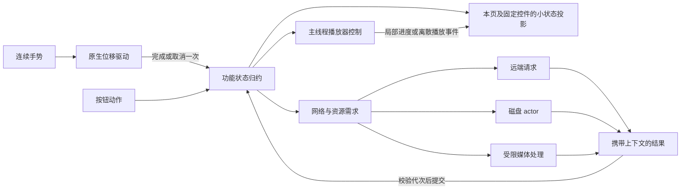
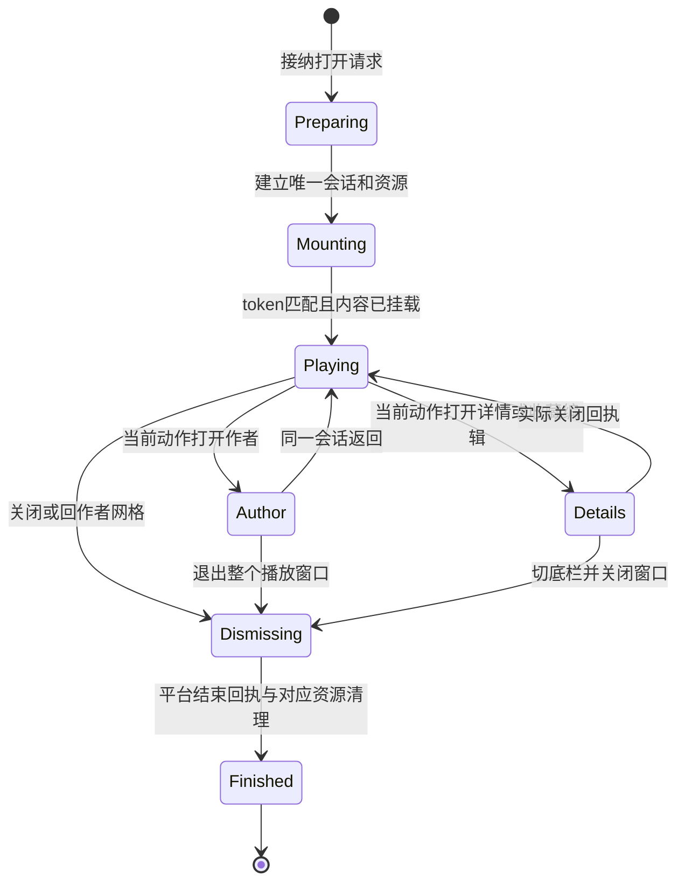
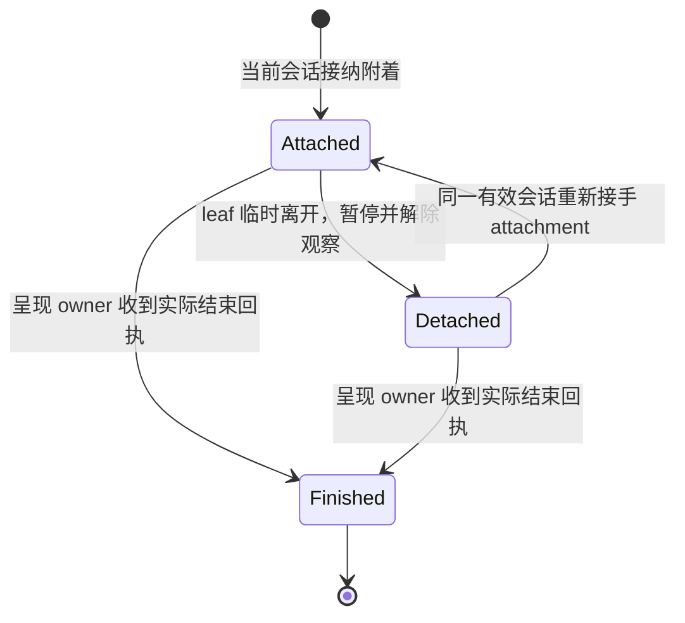

# 播放、导航与加载的职责边界

状态：用户已批准实施；与 HG 独立审查 v1.1 对齐，先保留基线，再分模块实施。适用于 Civit Viewer 的时间线、作者、搜索、收藏本地播放和历史播放。目标是消除无效工作、稳定页面与路由身份，同时保留完整媒体画布、固定顶底栏、会话内位置和唯一活跃播放器。2026-11-16 用户要求先明确边界，再重构。

## 已知问题与证据边界

- 尾部拖动：`NativeMediaPager.boundaryGateEnded` 每次 move 回调写入 `MediaDeck.boundaryDragOffset`，触发 `receive → refreshHosts`，对最多三个已有宿主重赋 `rootView`。这是多页内容更新，不等同每次新建三个播放器。
- 磁盘：`MediaCache` 是 MainActor；生成封面同步校验、原子写盘，前后各 `trim` 一次；`trim` 扫描目录、读取属性并排序。`cached` 命中还同步更新文件时间。这些执行路径已确认；它们分别占本次卡顿多少时间尚未测得。
- 几何：MediaDeck 在祖先忽略安全区之后读局部 safeAreaInsets，可能得到零；整页播放又没有给 continuation 指定顶栏让位。可解释截图顶部文字及进度条与底栏重叠。
- 作者闪回：用户澄清为作者页闪后回播放，不是进程退出。收藏本地播放走 NavigationStack push；作者作品播放另有“回当前作者网格”的业务回调。当前没有证明是系统写回 nil、宿主重建还是误触返回，不先改成另一套导航掩盖未知原因。
- 本轮新的同路径性能基线尚未完成；不能把构建成功或旧的约 341 ms 停顿当作本轮修复前后对比。

## 远端与本地的边界

远端后端指已有 Civitai 站点，负责账号授权、作品和作者数据、分页游标、站点收藏及关注结果。客户端没有该站点服务端修改权限。本方案不新增代理服务，也不把手势或播放状态送到服务器。

本地数据层负责请求调度、响应处理、分页合并、去重、缓存、离线文件、历史保存和预载计划；它不操作视图、导航或 AVPlayer。界面层只显示面向当前页面的状态，发出用户动作。播放器和导航各有自己的控制层。

| 责任 | 唯一持有者 | 执行方式 | 不允许承担的工作 |
| --- | --- | --- | --- |
| 每个时间线／搜索／作者列表的筛选、游标、队列、当前作品、位置 | 各自稳定的功能 owner 持有焦点和位置，FeedStore 只持有分页与队列数据 | MainActor 串行归约动作，重处理通过 effect 执行 | 不持有手指每帧位移，不直接扫描文件 |
| 网络传输与响应处理 | 请求服务和受限数据处理 worker | URLSession 异步；较重解析、过滤和合并离开 UI 热路径 | 不在响应回调里直接改变导航；不以 Task 语法当作后台执行证明 |
| 缓存目录、索引、代次、文件占用、容量预留和逐出 | 一个 MediaDiskStore actor | 串行文件事务，分批扫描；前台资源解析优先于维护 | MainActor 镜像不能授权删除、预算提交或声明文件存在 |
| 图片校验、缩图、封面提取、兼容转换 | 各自有界 worker | 异步、可取消；转换沿用已有修复队列 | 不持有 UI 对象；不无限并发 |
| 当前播放、暂停、seek、active lease、AVPlayerItem 就绪 | 现有播放会话控制层 | MainActor 执行框架控制与短小状态提交，媒体加载异步 | 不扫描缓存目录，不因进度变化重配列表 |
| 三页可视窗口和交互完成 | 原生 pager | 稳定宿主；原生交互和按需复用 | 不把每帧位移发给整个业务对象 |
| 页面绘制输入 | 每作品稳定的 PageModel / 小状态投影 | 只观察本页实际需要的字段 | 不观察完整历史、整个缓存统计或全部列表加载状态 |
| 作者／详情／编辑等路由 | 稳定的播放页面或根堆栈持有者 | MainActor 明确 open/close/commit/cancel | 媒体子页消失、海报更新、像素层清理不能决定路由存在与否 |
| 顶底栏、物理安全区与内容让位 | 当前页面 shell | 一份几何输入，旋转时更新 | 不从已忽略安全区的子树推测真实安全区 |

“同步”表示短小、顺序明确的状态或 UI 提交，不表示让主线程等待下载、文件或解码。AVPlayer 的控制留在 MainActor；不能把整个播放器对象粗暴搬到后台线程。

## 单向动作与异步结果

使用轻量单向数据流和明确的状态机，不引入大型全局 Store。重用现有请求取消、队列 revision 和播放 lease，统一其职责，不再叠加一组互相推导的布尔状态。

每份异步结果至少绑定账号／会话、来源和筛选 key、请求代次；文件结果另含缓存代次和资源 revision。只在这些身份仍有效时提交。取消是减少工作，结果身份校验才是防迟到污染的最终约束。

同一功能内一次业务事件只提交一份一致的状态；不靠连续修改多个 Published 字段让其他层猜测中间态。状态相等不发布，但只比较该事件涉及的短小输入或单调 revision，不在拖动／进度回调里深比较或哈希整份列表。不同功能不订阅对方完整对象。

## 哪些变化真的需要更新

| 事件 | 必须立即同步的部分 | 异步或延后部分 | 允许更新范围 | 明确不做 |
| --- | --- | --- | --- | --- |
| 手指 move | 现有内容 layer／view transform、必要的跟手指示 | 无网络、磁盘或新解码任务 | 位移层 | 不改队列、路由、focused，不重设 host.rootView |
| 进入新的预览目标 | 记录一次目标身份，准备已有预览宿主 | 缺失资源提出一次有代次的需求 | 新目标页／预览 | 不按每个像素重复申请同一资源 |
| 手势取消 | 动画回原位，保留原焦点及播放器意图 | 撤销不再需要的投机任务 | 当前位移层 | 不清历史、不刷新列表、不重载当前视频 |
| 翻页完成 | 焦点只提交一次，先暂停原 active 再授予目标 active | 保存历史、补新的远端邻页、必要预热 | 旧／新当前页的 active 状态、确实新进入窗口的一页 | 不无差别重建三页，不重新请求已经有效的数据 |
| 切关注／推荐或图片／视频 | 选择相应已保留状态和当前位置，完成一次播放交接 | 仅缺失或失效的数据和资源继续加载 | 目标分栏；栏只改选中态 | 不把其他分栏清空，不所有分栏同时刷新 |
| 播放时间与缓冲变化 | 进度控件必要的显示值；seek 反馈 | 节流合并历史保存 | 当前进度控件，缓冲值确有差异才发布 | 不刷新整个 deck、作者页、顶底栏、其他页 |
| 下载／预载进度 | 内存中记录最新值 | 合并 UI 展示与持久化 | 对应角标或任务行 | 不广播整份资源集合给整个 App |
| 分页响应 | 验证请求身份，原子提交实际队列差异 | 解析／过滤／去重在有界数据任务执行 | 新增／变化的作品和分页状态 | 重复页、迟到页、同内容结果不刷新现有宿主 |
| 海报完成 | 校验作品与资源代次，更新该页海报 | 校验／编码／落盘在 worker 和磁盘层 | 对应媒体页 | 不重新 configure pager，不导航、不重载当前 AVPlayer |
| 打开作者 | 路由 owner 记录一次请求，转场拥有自己的 token | 作者数据异步加载 | 作者页及播放覆盖暂停状态 | 来源子页 onDisappear 不撤销作者路由 |
| 取消／返回作者 | 同一路由 owner 结束该目的页，恢复原播放意图 | 无效资源需求取消 | 对应页面与播放状态 | 不清其他页面位置，不以截图撤除决定业务 pop |
| 主题／旋转／字号改变 | 更新一次布局输入和必要的可见控件 | 按需更新媒体布局 | 当前与相邻预览的几何 | 不使媒体身份、播放器或网络请求失效 |
| 缓存命中 | UI 只消费内存索引提示；实际打开前取得有效文件 lease | actor 验证文件，合并 touch 更新 | 该资源请求者 | 命中不扫描目录、不每次同步写 mtime、不触发全屏发布 |
| 清理浏览缓存 | 使旧缓存任务失效，保留当前合法播放和受保护资源 | actor 执行 generation fence、清理可逐出文件 | 缓存展示与受影响请求者 | 不清离线收藏，不因清浏览缓存无条件停播；旧任务不得重建已清资源 |
| 切账号／退出账号 | 使旧账号请求与路由失效，暂停不再授权的播放 | actor 按原有隐私策略切换上下文，保存／清理相应数据 | 账号相关功能 | 旧账号结果不得进入新账号，不擅自扩大删除范围 |

这张表允许必要的两页 active 状态变化；“翻页只更新一条”准确指补窗口只需要新增一条，不应为了口号阻止旧当前暂停、新当前激活。

## 页面、文件和播放器的复用

三者不是同一个缓存，分别定义身份和预算。

- 页面窗口保留当前及前后页，沿用稳定的作品身份与队列上下文；普通前进只补新进入窗口的一页。移除远端宿主时释放它自己的观察和需求，不撤销独立的作者路由。
- 普通分页追加不改变现有作品身份；队列代次只在真正更换数据上下文时失效。PageModel／页面身份由账号、功能 scope、数据上下文和作品 ID 决定；实际媒体资源 revision 是独立的加载／播放器需求 key，资源替换可重新绑定媒体而不重建整页。分页成员 revision 不作为现有视图身份。committed focus 只由功能 owner 持有，PageModel 不另存一份互相竞争的焦点。单页宿主只在创建或真正更换页面身份时设置根内容；后续通过该页状态投影更新。metadata／资源／active／覆盖状态发生实际变化才通知对应页。不能通过忽略闭包的 Equatable 包装保留旧操作。稳定宿主的动作经稳定 dispatcher 解析当前会话和路由上下文，不永久捕获首次创建时的旧闭包。
- 文件缓存按资源身份、revision、容量、有效文件 lease 复用，不能把封面已准备等同视频已准备。
- 解码播放器继续保持当前有界预算和唯一 active lease。增加容量不作为本轮主线程修复。前后及跨分栏就绪需求由统一计划表达；容量2与3的选择后续使用相同负载、首帧、内存和失败指标对比决定，不默认让四个分栏都后台解码。
- 功能分栏保留会话内筛选、队列和位置，不承诺所有页面永久持有播放器。内存压力下只回收可恢复资源，保护当前页与有效路由；回收后按保留位置恢复。

## 磁盘与异步提交的安全合同

磁盘 actor 同时拥有缓存 generation、pin 引用计数、预算预留和最终逐出判定。不能拿一份旧 pins 快照给后台扫描后直接删除文件。扫描、文件属性读取、读写、移动、逐出都不在 MainActor 执行。

数据输入是资源 key、来源身份、缓存代次、期望 revision 和消费 token；输出是带 lease 的就绪文件、缺失或类型化失败、必要的统计快照。UIImage、AVPlayer、视图及 UI 回调不进入磁盘事务。资源解码 worker 输出不可变处理结果，再由 actor 校验并提交。文件 lease 必须先由 actor 验证并 pin，才把文件交给 MainActor 创建／晋升播放器；等待期间取消、上下文失效或消费方消失时，按 lease ID 幂等释放。不能把原同步 pin 闭包改成 fire-and-forget 的 Task 后，仍立即创建播放器。

处理耗时任务期间若发生 await，提交前必须重新验证 generation／pin／预算；最终 rename、索引提交和 lease 授予使用短小串行事务。扫描维护分批执行，避免长期占住 actor；前台打开资源不被大规模维护排到最后。历史保存沿用现有数据库隔离与节流，只对展示值变化发布局部结果。

现有同步 `cached/hasGeneratedPoster/reserveRepairBudget` 中，要求文件真实性和准确预算的接口须迁移到 async lease／预留接口；MainActor 中的提示索引不能冒充真实授权。不得用 semaphore、主线程阻塞等待或 fire-and-forget 绕过这个边界。

## 布局与导航状态

播放 shell 在忽略安全区前测量物理 safe insets，并把固定栏的实际 clearance 传给内容。完整媒体画布仍覆盖整屏；caption、seek 的44 pt命中区、侧栏和 continuation HUD 必须避开固定栏。滚动内容 margins 与播放器控件 clearance 分开，不逐入口补魔数。

导航保留单独的路由身份与 owner。播放被作者或详情覆盖是 coveredPaused，不是 inactive／retired；确认关闭作者后才恢复原播放意图。转场状态是 idle → dragging → settling → completed/cancelled，只有明确业务动作能改路由；旧 completion 必须匹配同一 flight 才能收尾。转场层仅拥有视觉、交互屏蔽和清理权，没有收藏写入或路由删除权。

## 参考与适用范围

- HG `src/components/IOSTabSwipe.tsx:34,143`：连续 move 通过 ref/CSS变量画位移，首次目标建立预览，finish 才提交选择；`src/App.tsx:114` 以稳定 page.key 保留堆栈。借鉴职责边界，不复制 Web 技术栈。
- EH `App/ReaderView.swift:469,948`：按 page index 保留身份，只有 preview 改变才更新媒体需求；`App/ExViewerApp.swift:129` 与 `GalleryNavigation.swift:9` 将路由放在稳定 owner。EH 仍有位移状态更新，不能声称它从不重绘。
- [Apple：文件系统性能与稳定性](https://developer.apple.com/documentation/foundation/improving-performance-and-stability-when-accessing-the-file-system)：避免主线程立即文件 I/O。
- [Apple：Demystify SwiftUI](https://developer.apple.com/videos/play/wwdc2021/10022/)：页面 identity、lifetime 与 dependencies。
- [Apple：AVPlayer](https://developer.apple.com/documentation/avfoundation/avplayer)：播放器控制与 preroll 能力；预热不等同已显示视频帧。

本地 HG/EH 参考仅证明当前实现机制，不证明它们所有场景都没有性能问题；本方案是 Civit 的具体设计，不冒充平台强制的时间流播放器标准。

## 实施和验收顺序

1. 固定作者末页拖动、收藏本地播放点作者、中间页连续前后翻、分栏切换四条负载。记录真实画面、焦点／路由身份、必要宿主更新和播放器创建计数；采样 MainActor CPU、主线程文件工作及内存。未获得基线就不写性能改善百分比。
2. 统一几何合同和手势位移边界，消除每 move 全宿主根赋值。验证 move 不重配媒体需求，完成／取消只提交一次；全屏画布和栏位置不变，HUD／seek／rail 与栏不重叠。
3. 迁移磁盘所有权及同步读取调用，验证 pin、clear 后迟到结果、容量不足、文件缺失、取消、切账号和故障恢复。用相同缓存条目规模比较冷暖路径。
4. 单页状态投影与渲染输入收敛，移除无关历史／统计的全页订阅，证明只更新改变的作品。维持必要 active／覆盖变化，防止出现“快了但状态旧了”。
5. 根据作者闪回的路由读回修复具体状态所有权；验证首次进入、重复进入、覆盖、返回、半程取消和迟到回调。另检查下一条后立刻反向的播放恢复。
6. 最后再评估播放器预算和多方向资源计划；同负载对比首帧／创建次数／当前播放掉帧／内存，不靠无限预载换顺滑。

每阶段绑定源码与前后证据，独立审核受影响合同，必要回归通过后才覆盖安装。当前173作为可回退版本；不同时重写原生 pager、网络层、播放器池和导航，避免无法归因。阶段可以回退，但不以保留原有主线程重活结束整轮重构。

## HG 审查对齐记录

已读 `docs/reviews/hg-independent-review-20261116.md` v1.1（基线41b62fa）。原会话是生产代码唯一集成者；HG只写其独立审查文件，运行资源由原会话安排。

采纳项：已提交查询不再统一等待250 ms，输入草稿的防抖留在输入层；RootTabHost每slot按实际输入投影发布，latest动作上下文独立刷新；根手势开始需取得flight的明确结果，失败不能晚提交，普通点击视觉失败可在相同有效owner/identity下无动画降级；单项DownloadJob与完整InventorySync分离；资源解码使用带revision/像素档/动画策略的key并合并消费者；磁盘lease/预算/代次和最终提交由同一writer维护。

边界：WKWebView与授权检查仍在MainActor，较重JSON/DTO处理移出；Swift任务取消和传输真正停止分开描述。可靠后台下载/断点续传独立后续，不作为本轮已完成能力。三页宿主预算与播放器预算分开，不扩容量掩盖主线程重活；保留已验证的active lease、请求代次、离线write permit和完整同步判定。

同路径基线目前已复现作者末页HUD y=8、seek44pt区域与固定footer重叠；受控本地收藏进入作者停留暂通过，真实闪回仍UNKNOWN。首次Instruments按名称误附runner、随后精确PID附着未正常结束，均不作为性能结果；正在补单App进程sample与已有CADisplayLink帧间隔记录。新基线成功、源码变更及后续验收另记验证文档，不回写为本设计已实现。

## 实施中确认的呈现会话边界

缓存播放进入作者页的持久事件证明：按钮点击、作者解析和 action dispatcher 的身份校验全部成功；同一个外层 cover 尚未关闭时，内部 FeedMediaViewer 被替换，原先属于它的作者路由随本地 State 丢失。只观察单个 native pager 的日志会把旧实例事件一起丢掉，不能据此判断按钮未收到输入。固定呈现 ID、恒定呈现配色和跳过顶栏准备的控制实验均未解决，因此不将这次重建归因为其中任何一项。

路由及播放资源改由每次 cover 的独立 PlaybackNavigationOwner 持有。会话 token、作者顶栏 route 和 MediaDeckPresentationLease 均在创建时固定；下一次打开创建新的 owner，不在同一个 owner 上替换资源。Feed 和 History 统一消费此 owner，并把具体的 route／lease 作为不可变输入传给 Navigation 和 Deck。Leaf 的迟到清理始终指向旧资源，不能从长寿对象重新读取“当前会话”后误清新资源。

同一 cover 内，替代导航视图用独立 consumer UUID 登记。Binding 写回及作者、关闭、边缘操作在执行副作用前校验创建回调时捕获的 session 和 consumer；旧导航视图的迟到 nil 写回不能清掉新视图的作者路由。MediaCover 的 rotate／切底栏操作另校验平台提供的 token 与 mayClose。平台实际结束回执负责显式清理对应播放器和 chrome；叶子 onDisappear 不拥有路由删除权。

播放器文件 lease 与视图 attachment 分开。文件 lease 防止解码／播放期间文件被逐出；attachment 表示当前有权操作某个池条目的视图消费者。重新接手同一个 AVPlayer 时更换 attachment，保留播放器对象。player、KVO、timeObserver、暂停、覆盖保留和释放均校验该 attachment。旧消费者不能清除新消费者安装的观察者。首帧就绪恢复用同一 entry、输入 URL 和 AVPlayerItem 身份核实，不能因为接手时 token 短暂不匹配就清零，也不能从旧视图继承未经核实的 ready 布尔值。

本地文件维护最终使用 actor 内单次 lstat 取得普通文件大小与私有版本信息；外部 lease／repair identity 沿用原有合同。零字节是有效大小，非普通文件和读取失败保留 UNKNOWN。同一 2,000 个 1 KiB 文件、三轮完整暖扫描实测：基线 13.05／13.37／13.70 ms，新实现 13.04／14.01／13.78 ms；MainActor 探针最长排队由 10.32／11.61／10.93 ms 降到 0.027／0.015／0.017 ms。每轮均核对 2,000 文件及 2,048,000 bytes。该证据只覆盖 macOS CLI 暖扫描与主 actor 调度，不代表 iOS 整体帧率。原始证据保存在 build/cache174-perf/post-stat；安装放行仍需最终冻结版本的 UI 回归与性能对照。

整页播放的会话资源由具体的 MediaCoverSessionContent 在 View.body 内通过 Binding 观察；escaping 的平台 content factory 不承担 source State 的观察。只有平台 token 与 owner 匹配时创建播放内容，因此播放页不会先用占位 owner 登记 chrome，再在同一视图上切换资源。consumer 仍在首次出现和 owner identity 变化时登记。旋转与其他媒体动作一样，经来源校验后的 dispatcher 交给当前会话，不能绕过会话调用另一份过期闭包。

以下状态图描述整页播放入口；原生窗口的实际挂载／结束回执与业务路由分开。作者作品的“回作者网格”是关闭当前播放窗口，普通作品的“打开作者”才进入作者覆盖状态。

这里的 Playing 是播放页面可见，不表示视频必定在播放；手动暂停、素材就绪和唯一 active 播放器是另外的状态。返回保留原来的暂停意图，不能因为页面重新可见就无条件开始播放。

## 控件状态的观察边界

搜索结果进入播放的回归暴露了另一条闭环：同一个呈现 token、owner 和 chrome scope 未结束，内部 Deck 却不断 appear／disappear；begin／end 每次向所有 ObservableObject 消费者广播，触发下一轮呈现根更新。安全区数值恒定、取消安全区 State 回写、单独下放标题栏观察以及包裹搜索 source 均未中断循环，实验改动已撤回。只在诊断构建中跳过 chrome 注册后，首次进入及翻页恢复；此实验仅确立注册是必要反馈边，不作为功能验收。

正式实现保留完整注册、scope 顺序和 overlay 策略，改用 Observation 按实际字段建立依赖。动作消费者仅持有 controller 引用；标题栏、rail、清屏和手势排除区分别读取实际需要的状态。scopes、overlays、activeScope、hidden 和 departingRailScope 保持可观察，不能通过隐藏必要依赖换取少刷新。根主题只读取存储的 hasInlinePlayer 投影；begin／end 成功后同步，值未改变就不写，避免全屏 scope 增删无端刷新根主题。

生产 controller 的提取测试覆盖 16 项真实状态与 Observation 通知，包括非前台 scope 移除、重叠 overlay、rail departure／恢复和根主题无关更新。首次搜索进入、前后翻页、详情和作者返回已恢复 settled；完整重新进入、各入口回归及最终性能对照仍按冻结源码重新验收。诊断计数器和跳过注册逻辑均已移除。

## 呈现结束与渲染附着分开

清屏定向回归确认了另一条生命周期问题：toggle 已把 hidden 设为 true，紧接着 leaf 重建的 onDisappear 调用 chrome.end，新 leaf 的 begin 又把 hidden 重置为 false。平台呈现仍然打开，因此这不是一次业务退出。外置 MediaDeckPresentationLease 现在由带 token 的 PlaybackNavigationOwner 负责最终 finish；leaf 只取消自身 continuation/prefetch/repair 等工作并解除播放器附着。session=nil 的 fallback 和 inline 保留原来的 leaf 清理规则。

外置 lease 的 finished 不可逆，显式 finish 幂等。chrome 注册、媒体准备 await 后、compat await 后和候选播放器提交都必须检查它，迟到工作不能复活已结束的呈现。临时 detach 只允许当前 focus、有效 attachment、完整源匹配、ready、前台且无恢复／交互 seek 的条目进入 coveredPaused；实际调用 pool.pause 和停止 observers。普通 active=false、换源、翻页仍走释放路径，不能把整个会话窗口都保留成 covered 占住两槽预算。

播放意图也不能只属于可替换的 surface State。播放器 entry 保存显式 playing 值及当时的 autoplay 偏好；同一源重新附着时，只在新 leaf 没有自己的显式值且偏好未改变时恢复。用户点击通过当前 attachment 写入；autoplay 设置改变则清除旧覆盖。不从 AVPlayer.rate 推断意图，因为 coveredPaused 本身会把 rate 置零。定向 UI 已验证 autoplay=YES 后实际播放、用户单击暂停、两轮清屏／恢复时同 player、进度不前进、intent=false、rate=0，且池不超过两项。
