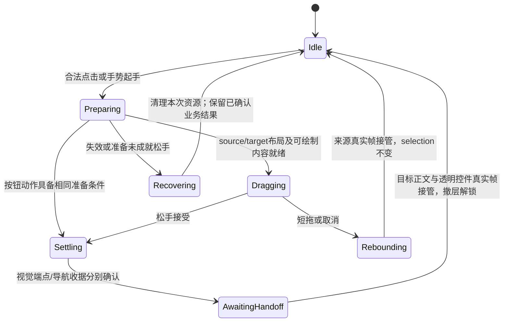

# 181：历史需求核对与共享呈现重构

本次检查以本会话的最终用户决定为准。180 已按再次明确要求覆盖，99 条离线记录索引及应用数据元信息未变，已接受静音启动。180 的构建、缓存测试和静态审核通过，但切页绘制未通过完整回归，不能视为本轮问题已解决。本文件保留180的修复前证据和181的实现合同；开工矩阵中的缺陷状态属于历史基线。当前源码、独立审查和运行验证分别记录在 `docs/ui181-validation.md`，不得把架构实现、UI用例通过和手机验收互相替代。

## 已确认的结构错误

以下证据对应保留在 `build/181-ui/baseline180` 的修复前代码；不能用这张表描述当前181实现。当前代码的独立审查与运行结果另记在文末。

| 问题 | 180 基线代码证据 | 影响与证据边界 |
| --- | --- | --- |
| 悬浮栏越界生产背景 | `TimelineTabGesture.compactBar` 使用 `PageToneBarCanvas`；`AppTheme` 的 bar surface/ink/canvas 读取多套 tone；`PlaybackTabsBar` 自建 clock | 栏下方像素及控件外观不再由页面独占。源码可证；具体现场坏帧需同路径录屏对应 |
| 终态交接只核顶栏 | `PageBodyHandoff.releaseRootInteractive` 等 header ACK；footer 只验 frame。root 控件快照直接画目标样式，live footer 却仍读暂停在 0 的 clock | 位置和导航收据正确，仍可能在撤快照后才更新底栏配色与下方背景。正反方向都可达 |
| 页面与播放器竞争决定主题 | `AppRootAppearance.preferredColorScheme` 读 `chrome.hasInlinePlayer`；MainTabs 读 selected/prepared canvas role | 离开立即 endInline，回来等 deck 注册，页面角色和播放器生命期成为两个外观触发器 |
| 多条返回路由各做一次外观动画 | root、普通 edge、business cover、PlaybackTabsBar、从播放切根页各有交接/补色分支 | 修一个 root header 不会修掉作者返回、详情、离线/兼容播放和覆盖退出中的重复画布 |
| 媒体一帧有多个呈现决策者 | `CachedPoster.preview` 可画真封面或文字图标；VideoSurface 的 spinner 只排除 imageOnly；邻页 needsTransitionFallback 不要求 active | 真封面+圈、占位图标+圈均可同时绘制；onChange 回传 ready 又晚于子视图实际拿图 |
| 预取和展示没有同一资源身份 | MediaPreloader 取 raw poster；loadPoster 取派生 450 候选；TimelinePageMotion 另取 raw/2048 | 做过文件预取不等于正式封面或手势预览已经解码就绪。不能靠加更多请求解决 |
| 卡片与首屏状态混在可选数组里 | 作者/搜索在新 request key 未到时传 `previewItems: []`；网格由该数组抑制 loading/continuation；卡片另叠 badge/error/placeholder | 新请求、真实空结果和旧 feed 结束状态不够独立；卡片没图时也出现内容式占位 |
| 验证单元小于真实缺陷单元 | 180 审查集中在三文件 header ACK；host158不绘制UI；内部QA setup失败未执行路线 | 静态或数据层通过不能替代顶栏、正文、底栏及安全区同帧连续性。这是之前反复漏项的验证错误 |

root 的 `installRootCanvas` 已删除通用安全区色带、改用整屏 planes；不能误说 root 同时还在安装这些旧色带。普通返回/cover 的 header/footer 背景带与 root live footer 的额外 canvas 是各自需要处理的路径。

## 历史需求与181开工核对

下表第三列是181开工时状态，保留用于追溯遗漏，不是当前完成状态。“源码已接”只说明当时查到入口，当前运行状态见验证记录。

| 约定 | 最终要求 | 开工时状态 |
| --- | --- | --- |
| 顶栏、底栏 | 独立、固定位置、透明悬浮；只管控件切换，不生产底下页面背景 | 核心实现违约，本轮必须重构 |
| 整屏画布 | 状态栏到 Home 指示条均显示本页真实内容；让位是内容边距，不能截短画布 | viewport 已接；返回/cover 仍有重复背景生产者 |
| 所有进入/退出 | 优先横滑；手势跟手、取消回原位；目标到位后不再移一次或闪一下 | 多路 adapter 已接，终态和透明性未统一 |
| 底栏四根页 | 时间线、作者榜、搜索、收藏；点击有动画，其余根页边缘切主页面 | 根顺序 `[0,2,4,3]` 已接；双向颜色和底部缺陷未过 |
| 时间线边缘 | 保留关注/推荐、图片/视频规则；预加载多方向可达目标 | 已有预载，但资源键、并行时机、预览交接存在缺陷 |
| 作者/榜/收藏分栏 | 中央横滑切本页同级分栏，子页边缘返回 | 三者显式中央切栏已接 |
| 历史分栏 | 沿用最终浏览手势规则：中央切图片/视频，两边返回 | 仍使用旧 edge 默认，需修；这是全局约定在历史页的应用 |
| 配置页 | 两边返回；有选择器也不抢成切栏 | 标准返回已接，逐模板回归 |
| 本地草稿 | 成功返回才生效；短拖取消不提交；即时设置保持原语义 | filter/tag/author receipt 已接，必须保住 |
| 云端写入 | 收藏编辑/账号偏好明确确认；返回不隐式写云端 | 显式确认已接，保存期退出策略需统一核对 |
| 缓存/离线播放 | 与在线共用操作；两边跟手退出；作者往返保播放意图 | playback owner/lease 已接，视觉走独立旧路径 |
| 搜索单双排 | 顶边固定；展开下沿、下排裁切展开，再换首排；返回逆序；正文提前让位 | header adapter 已接，实际顺序及回程需复验 |
| 排序/搜索文案 | 排序在第二排并对齐四格；作者入口短文案，不截成“限…” | 源码入口已接，窄屏/大字复验 |
| 每页状态 | 会话内切根页、进出子页保筛选、分栏、队列、焦点、滚动位置 | root保留host；各功能有anchor；实际复用不能靠名字认定 |
| 错误反馈 | 已有错误统一居中toast；没有提示的地方不硬加 | window center host 已接；网格仍有正文时长错误需收口 |
| 卡片无封面 | 只改卡片内部：固定尺寸，中性纯色；无文字/编号/大图标，无圈叠层 | 共享placeholder/card叠层违约，本轮必须修 |
| 卡片暖缓存 | 同一作品有效封面继续使用，不反复闪内容式占位 | 文件/解码有缓存，view重挂仍经placeholder；需同资源复用 |
| 作者预载 | 提前准备即将看的首屏/附近小图，合并请求，不全量抓作者库或原视频 | 没有明确入口预暖与展示消费合同，需补有界路径 |
| 首次视频显示 | 封面/过渡帧/加载提示互斥；已有图稳定保留到native接管 | 多个布尔分支冲突，本轮必须改成统一呈现投影 |
| 播放后重缓冲 | 保住已显示原生帧；手动暂停/清屏不出现假等待 | 既有回归已约定，与首次加载分开保留 |
| 首次数据加载 | 未请求、加载、真空结果、失败分开；不先闪空再加载 | 新request传空数组的路径需纠正 |
| 我的关注 | 排序进顶栏；标题不带人数，人数在最底；居中轻量loading；账号隔离缓存 | 源码已接 |
| 历史管理 | 长按多选，仅收藏+删除记录；更多清空；确认文案短 | 源码已接，手势仍有旧分支 |
| 诊断 | 三点清空/导出；删除长介绍及“最新在前”标题 | 源码已接 |
| 本地标签库 | 三点动作、简短可理解状态，不展示内部术语长文案 | 入口已接，运行文案需状态样本核对 |
| 屏蔽作者 | 标准间距、短提示；解除去设置；列表有通用序号 | 源码已接 |
| 屏蔽标签 | 与选择/配置页对齐，边缘返回不抢切栏 | 标准模板已接，实际回归 |
| 收藏 | 收藏即下载；现成作品不写“已下载”，只有必要角标 | 源码已接 |
| 收藏多选 | 长按后同一底栏添加/移除/返回，不叠两层管理栏 | 已有batch入口，唯一实际footer宿主需与共享呈现一起核对 |
| 下载管理 | 任务/空间切换；任务不列已完成，空间不重复文件列表 | 源码已接 |
| 下载/侧栏设置 | 有明确意义的恢复默认；已默认时禁用 | 源码已接 |
| 设置入口 | 去掉无用手势帮助、重复收藏管理/离线文件入口和顶部浮动标识 | 入口已移除；共享背景问题仍影响外观 |
| 开源组件 | 顶栏动作有意义，长正文使用统一浏览层级 | 官网按钮已接，正文仍直接全文；目录分层来自navigation-design-v2第8项，属于历史设计补齐，不作为核心动效额外门禁 |
| 明暗/旋转/清屏 | 同路线第一帧正确，无白边圆弧缺口；固定栏不漂移 | 历史专项证据不能替代本次统一回归 |
| 静音/安装 | 回归静音；保留原签名、Keychain、账号、离线数据 | 180覆盖已验证99索引及210/1/688元信息连续性 |

## 重构边界

保留已有 route/session、实际导航 receipt、active player lease、磁盘 actor 和功能 store。修复不新建全局导航框架，不扩大播放器池，不把全量列表或逐帧手势放回 SwiftUI 业务状态，也不修改 Civitai 服务端。

### 页面与悬浮控件

| 抽象 | 现有承载位置 | 唯一职责 |
| --- | --- | --- |
| 导航意图与实际结果 | RootTabHost / PlaybackNavigationOwner / PageReturnCommit / PresentationLifecycle | 哪个页面存在、是否选中、平台实际pop/dismiss、成功/取消；不画背景 |
| 一次视觉会话 | TabPageMotion / PageEdgeReturn / BusinessPagePresentation 适配，组合 PageBodyHandoff | 本次窗口、source/target owner、token、进度、输入租约、有限等待、清理；一次动作一个owner |
| 页面画布 | 当前页面及 PageBodyHandoff 的整屏内容过渡 | 顶端至屏幕底边的一份内容；普通页底色或播放画布；包含安全区 |
| 悬浮控件 | NativeHeaderMotion、共用footer renderer | 控件内容、选中、可读性、顶栏高度/裁切；位置固定；不缓存或补画底下内容 |
| 媒体呈现 | 单作品的呈现投影 | 同一帧只能选择中性底、有效封面、已解码过渡帧或native画面之一 |
| 数据与预载 | FeedStore / MediaPreloader / MediaCache / bounded workers | 请求、合并、缓存、解码和可用结果；不触发页面动画或改变业务selection |

删除栏上的 `PageToneBarCanvas` 使用、`PlaybackTabsBar` 私有颜色clock、MainTabs因播放角色变化再盖的全窗色层，以及返回路径为栏另外做的 header/footer 背景带。控件需要副本时只含透明控件像素，不能把下面的视频或页面底色一起截图成静止条带。既有导航收据保留；root截图planes由下述真实宿主路径替换，不保留两套并行的正文渲染。

根页面进一步复用已保留的两个真实UIHostingController作为画布：RootTabHost持有token化visual pair，仅改变两份已有UIView的transform，不reparent、不更换rootView、不重建导航栈。prepare时两页先在identity完成布局，页各自拥有不透明整屏背景，再同一无隐式动画事务把目标放侧边。普通host update继续处理真实role，visual pair存续期不覆盖这两个view的显隐/位移/层级。接受后维持终点直到真实selection及顶底控件接管；取消或失效按已确认selection归位。正文不再需要root整屏/画布/底栏截图；PageBodyHandoff在root路径只持固定顶栏控件副本和输入租约。普通push/cover保留平台adapter，不和root一起替换导航容器。

源目标位移期间不能拿移动后的全局header位置作为每帧资格；身份、scope、window、extent负责中段校验，终点再核对绝对几何。底栏从实际root marker读取selected/role/batch owner/frame，跨渲染边界稳定后再交接，不从多个副本里取最靠上的frame。这个调整减少了root正文截图工作，实际合成成本与流畅度仍需运行测量；header进度仍有Observation，不宣称整条move零SwiftUI更新。

普通 `NavigationStack` push、按钮返回和预先绑定的作者路由，在 UIKit 提供精确两端控制器后接入同一导航进度。透明的 1 pt 代理只采样系统过渡的 presentation transform，固定顶栏的排数、控件和可读性使用这个进度。目标页使用自己的最终正文边距，pop 保留原滚动位置。页内搜索单双排使用专门的内容让位。UIKit completion 确认端点后，真实目标控件接管。实际控件与副本通过显式 drawable token 交换。普通导航在副本隐藏、真实页面可以接管触摸时归还输入，随后单独结算顶栏的渲染确认与播放许可。

普通页面保留原平台导航容器。进入或按钮返回先取一张排除显式悬浮控件的来源整屏内容，视觉会话只租借这一个plane，终态脱离并归位后才能放入最多三页的回程缓存。平台确认实际目标存在后，借用其真实UIView，登记owner、window、scene、父视图、本地bounds/center和原transform，再与来源同步横移；不拍第二张目标整屏截图、不reparent、不替换rootView。逐帧只验租约内的轻量身份和本地几何，首尾才解析完整viewport。边缘返回到p=1时已有目标缓存或中性内容停在最终位置，真实receipt之后只登记目标和交接，不再平移或重播一次动画。

从覆盖页底栏切根页走独立的薄适配器：当前画面固定后，按真实挂载的父子关系逐层请求关闭，每层只由系统onDismiss推进。业务onEnd和sourceRemoved不充当平台回执。中间页面和目标的activation许可保持关闭；新挂载意图按窗口排队，到终态再重新判断，不丢新意图，也不在间隙挂出新盖层。全部真实回执到达后，在来源plane下提交根选择，借用已保留的实际根页完成一次滑入。捕获失败且尚未发生平台动作时才能回到原动作；已经关闭一层后失效只交还实际已确认页面，不继续关闭、不伪造成功。

播放覆盖页主动关闭时产生的方向恢复，是本次导航的附带动作。跨层退出按真实 closing scope 登记，整次 root 交接完成或被中止后再按内层到外层顺序执行，不在冻结几何的中间改变窗口尺寸。恢复动作绑定原 `UIWindowScene`；若场景进入后台，保留到同一场景激活，新手动方向或自动旋转设置撤销旧意图。UIKit 已接收后拒绝的几何请求仍沿用原回滚策略，不新增无界重试。

activation许可只阻止新播放器获取、自动播放、曝光和新输入；可以准备metadata、磁盘和小封面。已有被覆盖的播放器沿用原covered lease，保留实际帧与手动暂停意图。所有许可、输入遮罩、来源plane及固定控件在同一终态中交接。系统减少动态效果仍保留这些收据与资格检查，只取消横向运动。

边缘手势和正文交接共用按动作 ID 归属的输入租约。拖动时由手势持有，提交后交给正文，平台拒绝关闭时租约随同正文一起交回手势，直至回弹收尾。根页面与全屏退出由各自的正文交接持有输入。顶栏在这些路径上提供控件副本和绘制确认。等待边缘返回的平台回执、等待真实画面接管各有时限。过期时清理该次动作的视觉资源，并按已确认的平台页面归位。延迟回调必须先核对动作身份，再写入或者清理状态。

普通页面主题与播放角色分离。系统明暗偏好仍由现有设置决定，页面是否是播放画布由该路由/分栏声明；不再用播放器是否刚注册来决定普通页首帧或悬浮栏背景。状态栏字色必须另验，不能为去掉颜色分叉丢失可读性。

### 视觉阶段与触发

1. **Preparing**：取得同一窗口的源/目标身份。预挂最终布局只用于已有双宿主的根页/分栏；普通push/整页cover按现有route及平台receipt正常挂载，不等待尚不存在的目标header。缓存画面或正确的中性内容即可，不等网络完成，不激活目标播放器、不记历史、不写云端。
2. **Dragging**：只由同一手势进度驱动正文位移和固定控件替换；不更新业务队列、不重设宿主根、不启动图片/视频网络请求。
3. **Settling / Rebounding**：用剩余距离和速度收尾到1或0；沿用已确认的有限时序，禁止结束后另开背景渐变。回弹不提交selection或本地草稿。
4. **AwaitingHandoff**：实际导航receipt与视觉端点可以先后到，但都必须确认。程序核对目标viewport、透明控件模型/几何及渲染边界；实际同帧像素由离线/QA录像验证。真实目标使用同一endpoint的正文、控件和最终内容边距；固定控件外的安全区像素由页面拥有。
5. **清理**：匹配token后一次撤过渡层、解除输入锁、释放对应资源。watchdog或身份失效时，以已确认路由为准立刻交还真实目标/来源，不等待像素、不倒放或重复动作。旧回调不能清新会话；已经committed的导航/云端结果不能被视觉中止改回cancelled。

顶栏单/双排仍按已确认的下沿展开→排内裁切→控件替换顺序，顶边不动，正文从准备时使用目标最终让位。底栏仅选中和操作内容切换，栏外到Home区域不画缓存底图。内部标签展开仅动画该容器的高度/裁切，不重播整个页面出现动画。

### 卡片和视频等待

网格的显示持有和请求许可分开：覆盖期间保留同一批最多24个槽位中已显示、资源身份匹配的图像；冻结期间不补入新槽位，加载任务以明确许可取消，缓存通知或URL升级也不能擅自启动新请求。实际离场、资源或账号身份变更仍释放；揭开后重新按真实视口准入。卡片内部无封面时保持固定几何和干净纯色，文字编号和大图标只可保留为无障碍描述，不画在封面区域。真实封面附带视频角标；无图不同时显示角标、中央图标和加载圈。失败保留一个轻量重试入口，不新增正文错误文案或新的toast。

媒体呈现由同一个已取得的图像结果和资源身份归约，不靠子视图画完后再异步回传一个ready布尔值决定父层spinner。准备邻页静默；首次准备有真实封面/过渡帧时稳定保留，native真正可显示时一次接管。只有active、已settled且露脸、前台、有播放意图的焦点完全无图并确实等待时，最多一个轻量延后提示，不能放在固定底栏附近反复闪动。native已播后的真实重缓冲与首次等待是不同状态，保住原生画面与既有小圈；暂停、清屏和非前台不展示假等待。

### 请求与预载边界

- 用同一 `CoverRequest` 表达source、declared及规范候选顺序，解码档位单独组成job身份；同档位合并，网格/全屏可不同尺寸，同资源先用已解码小图再异步升级，不把小图当native ready。复用现有MediaDecodeScheduler，不另加全局decoded缓存。下载文件完成和图像已解码分别记录。
- 手势move只消费已就绪图或已存在的本地帧，不在手势热路径临时取raw封面/2048解码。
- 继续沿用现有全局并发、文件预算、Wi-Fi策略和两槽播放器上限；优先当前项、上一/下一和两个真实可达时间线分栏目标。不同准备工作各自完成即提交，不被另一条慢请求串住。
- 作者入口只在明确接受打开动作后，准备一个候选作者的首屏元数据，最多一个传输页，立即提交路由不await。路由把同scope/作者/筛选/类型的同一个FeedStore和在途任务转交目的页；如adopt则仅接已完成同key结果，保留游标及过滤前数据，不能只复制visible rows或再activate另一store。没有明确用户意图时不对榜单每行抓作品。已进入作者页时，小封面覆盖当前视口与邻近一屏，预热窗口设显式上限，沿现有图片队列调度；不提前连续翻作者库。
- 预载不请求全部fallback，不为缺封面下载完整原视频，不为每张可见卡片无界启动本地提帧。已有poster/解码结果优先，本地缺图恢复受现有1运行+2等待队列保护。
- source、账号/站点、request attempt在异步提交前都校验。403/429/错误网页停止；取消释放该消费者，不停止其他仍在使用的共享请求。已有受控503单次重试合同不扩成循环。

## 实施与验证

先对齐这份共享边界，再按“页面画布/悬浮控件”“媒体呈现”“预载及卡片”三个互不抢writer的单元实施，root集成。历史/开源/旧错误反馈这些已发现的遗漏随后按页面清单补齐，不能被核心模块通过代替。

验证必须走真实路线：时间线↔作者榜/搜索/收藏的点击、成功拖动和取消；作者↔播放；缓存/历史/兼容播放↔作者及详情；搜索单/双排和边缘返回；所有配置/业务模板。用有纹理的本地静音素材逐帧同时看正文、透明控件内外间隙、状态栏和Home区；素材须在这些位置确有可辨像素，不能拿天然letterbox黑区按黑白阈值冒充透明通过。分别检查固定控件几何、底图运动方向、终点没有二次跳变，另验系统状态栏字色。冷/暖/缺图/错误文档/取消使用同一批资源核对请求数和显示层；会话筛选/焦点/滚动/暂停意图也读回。单测/ACK/构建不替代这些画面结论。

## 当前验证记录

完整证据与未完成项见 [181验证记录](ui181-validation.md)。181 已覆盖手机并实际读回版本、99条索引及210/1/599项元数据前后连续性；该结果来自本次设备采集，没有复用历史180交付。

- 根页、普通返回、覆盖层、控件宿主、封面与预载已按上述职责实施。高级独立审查发现的迟到取消、提前激活、普通导航二段动画和主动恢复方向竞争已逐项修复；结论绑定各次源码哈希。
- Run14实际手势7/7通过，无消费者的目标留白不再增加一轮等待。其计时区间为16次根切、16次目标准备，准备均值73.4ms；这不是GPU帧率或手指到首次位移的耗时。
- Run15的App编译通过，新增UITest引用了不存在的数字解析辅助函数，测试目标编译失败。该轮不能作UI通过证据；辅助函数已按既有字段解析器修正。
- Run16发现的作者缓存和新增播放器用例设置问题已修复，Run17实际8/8通过；最后收紧旧缓存清理后，Run18受影响路线5/5通过。最终冻结清单235项、独立复审、浅深色纹理像素和同条件ABBA对照均已记录。181重复根页准备均值56.68ms，对照重建180为90.28ms；首次冷建仍有额外成本，不宣称整体FPS提升。
- Release181和不可变签名包已通过原账号范围核对，覆盖安装及数据连续性已按本次设备收据读回。安装未自动启动App；真实站点慢网与手机体验仍单独验收。
