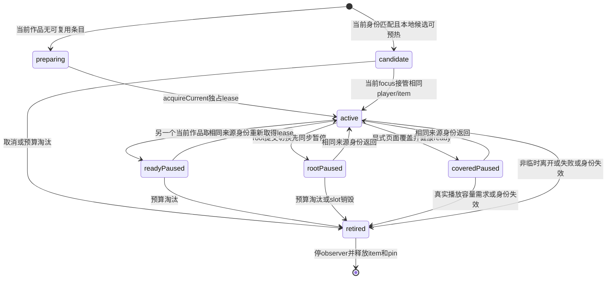

# 172 滑动卡顿与返回亮度调查

171已安装但整体卡顿、视频返回交接亮度差未验收。用户要求继续解决，保持模拟器静音，完成独立审核与回归后覆盖；未授权发布Git/Release或清理。

## 同路径基线

复用171最终optimized Debug QA binary运行testSustainedDragProfilerWindow167，同1000作者fixture、三轮上下/中央/根边缘动作。build/172-baseline-ui.log用例通过；Time Profiler有效46.885858秒、退出0，采样仅覆盖部分三轮，不当FPS证据。

首次作者榜→搜索phase epoch1794595948.733291；microhang绝对1794595948.985016–5949.450776，465.759833ms。主CPU样本292ms，明确beginRootSwitch约16ms，Combine共同objectWillChange witness50ms，SwiftUI未解析self140ms，partial71ms。精确binary UUID16DBCD7A…匹配；21个类witness共用地址，不能指认某个store。相同phase起1s冷/暖CPU权重417/218ms，增强首次graph/订阅成本候选，不能把全部未解析CPU归Search。build/172-baseline.trace、172-baseline-hangs.md；独立只读复核完成。

## 有界候选

隐藏邻source/kind原warm调用activate会跨过滤空页持续扫描；现在专用transportPageBudget=1，达到预算incomplete/ready，保留cursor，不改可见请求跨空页语义。同key重复warm不续扫。selectFilter会话内adoptPrepared完整COW accumulator与seenCursors，先验证identity/filter/source，不使用历史tail快照代替完整状态，隐藏源行保留。高级独立代码审核通过；FeedStore189与TimelineModel136项本地断言通过。

SearchView作品模式首次不挂隐藏作者结果页；首次切作者后保留同一pane、lookup、anchor与原active gates。这是测量候选，不先宣称消除465ms。

## 返回亮度

第一轮DEBUG同flight读回original、roundtrip及actual live raster采样RGBA完全一致（selected premultiplied77/77/77/77，track15/15/15/15，role playback），不支持双次raster损失或仅凭黑背景就说媒体透过。生产rasterizedControls缓存捷径实验已撤回。第二轮仅TimelineLane controls增加compositingGroup，作为live与栅格共同合成边界的视觉实验，尚待屏幕验收；没有drawingGroup强制位图化UIKit anchors。

171整体滑动和所有媒体canvas一致性仍不能宣称完成。第二轮UI/trace尚待运行与独立复核。

## 失败与下一轮

第二轮4/4功能通过，但Time Profiler停在Starting recording、40KB无有效数据，owned trace PID58471经SIGINT/终止退出1，未记零卡顿。compositingGroup视觉仍一条endpoint约+22灰阶，另一条稳定，VFR有2.0767s缺帧，不定位缺帧内因果；该生产试验已撤回。

第三轮同binary A/B使用4096条有界DEBUG display-callback gap记录（不是GPU FPS；阶段包括XCTest AX查询）。eager作者pane基线首轮root-edge max181.8ms，defer后199.7ms，没有改善；因此只延后pane不能作为修复。样本artifact build/172-third-ab-summary.json，两用例95.528/93.243s均通过。普通RootPageHost不读取tick状态，probe每tick只更新时间/计数，QA label仅在查询时序列化。

第四轮SearchView用@State普通SearchSessionResources按需创建/保留三个store，TagDestination轻量wrapper到body才取dir；新增初始全未创建、首次authors、tag返回、owner保留断言，原子pane仍观察store而不是普通resources。代码已独立审核，性能待测。

第四轮仅显式cover、NativeHeaderMotion idle时从owner自身drawHierarchy裁真实header像素，失败走canonical；同window/bounds/identity/traits的较晚disappearance不覆写exact缓存，下一cover仍刷新。最多3份缓存、失效/取消仍沿原规则。独立源码审核通过，draw成功不代表像素验收通过，需原始录屏。

## 双条目播放会话（172，回归中）

当前资源池全局最多2个AVPlayer/AVPlayerItem条目，只发放一个active lease。显式页面覆盖保留当前健康ready条目，根页面实际切走由RootHost先同步pause/撤lease，再让SwiftUI隐藏；返回复用同key、来源版本和文件身份的player/item。候选只使用已经落地的本地/完整缓存文件，静音preroll，不增加远程并发解码请求。页面离开、账户、来源版本和内存压力沿明确状态释放，candidate不得淘汰coveredPaused。

第八轮4项UI中作者边缘返回、root短返回、Search资源保留通过；播放会话用例作者返回段同playerID、creation计数、seek回调和位置均保持，连续滑播段第一条exact candidate ID失败。实际竞态为focus B提交后预载C可能先删除待晋升B；正在修正为按预期current workID验证后才移除旧candidate，不以“已preroll”替代实际晋升证明。

rootPaused冻结pool 5055d56e…版本62项原生AVFoundation检查通过，包括容量、单一lease、静音候选、preroll、slot/feed匹配、player/item复用及pin/observer清理。独立审核发现root同步pause与叶active更新之间的已排队事件窗口；VideoSurface现用ownsPlaybackLease统一约束reprepare、repair、seek、失败推进和display-ready，尚待本轮编译与审核。

NativeMediaPager的settled参数实际为id==currentID；手势willTransition不改变currentID，也不撤来源资格，取消保持来源。因此未新增猜测性的“拖动保留所有player”。

播放会话状态图（实际实现）：

prerollFinished独立于状态与layer首帧资格；candidate只静音预热，active lease只有一个。root撤lease后延迟native回执不得repair、seek、reprepare或推进不可用作品。预载需求需携带预期当前workID，B尚未接管时不得按C需求清除B。两条目预算的取舍是：进入另一个真实播放器时可能淘汰旧页面播放器，返回不能保证无重建；不能用无限池换取所有历史视频常驻。

第九轮：source manifest冻结，优化Debug模拟器 testPlaybackSessionsRetainCoveredAndPromoteNext172（38.408s）和testRootReturnRetainsWarmFramesPausedPositionAndIntent170（21.712s）全部通过。作者返回同player且不新增creation/seek；三次连续本地缓存视频晋升28172001/2/3均与之前candidate token完全一致，activation creation=0、poolCount=2、poolPlaying=1，bind→layer-ready QA分别42/36/33ms（不是整段手势延迟或真实网络首帧）。pool新SHA0b44dda…原生67项检查通过，覆盖focus已变而active未接管时不得删除待晋升candidate。日志build/172-ninth-run.log、172-playback-pool-final-checks.log。仍需最终独立源码审核。

第八轮原始screen复核纠正：6.30→6.493s正文ROI配准dy=0，平均RGB差0.007（同一缩小3倍screen域）；控件上半灰75.25→75.25，未选13→13，未复现控件自己变色。缺陷为cached副本从y348起可见，live媒体非黑像素从y280起，撤副本露出68px顶带；不能再把跨媒体边界row均值当controls亮度。原因边界是preparePreview按source作者aperture116pt裁目标media，target实际body62pt。最小修在PageReturnPreview保存已有mask的window bodyFrame，commit仅media目标使用该目标frame，手势中source aperture不改，普通页面不扩改。独立设计复核认为与证据吻合；栏内和栏外仍需第十轮实际screen分别验。

高级独立播放源码审核最终PASS：Pool0b44dda70474d3630ec5d9e9c03e437a68413161c20dc2dc2e5290febdb54fed，Surface e1670272bbc28279d25b944d129e44398af0578d61a64df161216a0be7e88aea，Viewer72217cf4bb8aa5d0ad131a434a91fa5c2bec2ad399eaa90a02b27db74a11e144，RootHostd9a6b279ae013c6cdd4931ff69200295c7b629fe72b7955f376ec7d1be2f684c。审核提出的recoveryTask启动与sleep后业务IO前lease/cancel/generation guard已补齐并读回。审核未替代UI或真实设备性能验收。

第十轮最终源码冻结3/3 UI通过：作者图片/视频button及双边edge返回43.493s；播放池作者button+左右边缘返回同player/position/intent并连续3条exact候选晋升49.839s；root短返回21.266s。build/172-tenth-run.log exit0；原始录屏build/172-tenth-author.mp4完整写入，媒体顶带需独立视觉复核结果。Release172沿用build/release169-derived输出目录构建，不新增并行派生目录；构建前可用空间103GiB。

顶带后续验收仍FAIL：第十轮crop改动未解决，原TimelineLane body marker本来就排除chromeHeight；62pt是owner起点，不能混当body起点。第十一轮nativepager band已捕到视频，但不含TimelineLane祖先scrim，媒体偏亮；第十二轮边缘返回两项UI实际失败，未安装；不能把新增registry/clone/geometry guard路径的功能失败当作播放池失败。这些候选不作为最终修复。

第十三轮改为在cover且flight idle、header尚未隐藏时从同owner原生完整画面裁完整header-band（包含真实scrim/controls），要求region包含header.frame且与正文无缝；去掉nativepager全局登记。可信band随同p放source上方、固定header下方；复用同UIView而不二次clone，取消/commit恢复到cache，和body在同receipt释放。trusted路径固定host目标controls/surface/border/黑canvas均透明，来源随1-p退出；HeaderHandoff独立绑定trusted目标，live probe重建不丢该能力，实际live/header/body与owner frame最终fence保留。正在冻结源码UI/原始录屏复核，尚未声称通过。

第十三轮功能2/2过，但原始录屏仍FAIL：手势p≈1的controls/栏内/栏外已与live一致，commit再截图复合band时出现白→黑带，正文不变。不能把hasCapturedPixels有对象当纹理完整。第十四轮新增trusted promotion nil安全取消：强制nil时未pop、source返回键可交互、locks0；三功能43.214/49.253/16.407s全过，高级源码审核PASS，但未作为消除白闪证据。

第十五轮最终候选去掉commit对band的二次截图：实际body116单独promotion，已正确显示的fullband原UIView直接转交PageBodyHandoff window overlay，同一token/receipt保留到live fence；remove/cancel release closure还回cache，不捕获flight/body；来源removeVisuals不偷走已移交band。目标owner/windowframe与live header/body fence、captured body像素资格继续验证。原始录屏与最终审核待结果。

第十五轮最终功能3/3通过：Author图片/视频button+双边返回44.699s，播放器保留+双边返回+连续3条exact候选晋升49.703s，forced promotion nil安全取消16.547s。build/172-fifteenth-run.log exit0。独立高级源码及原始像素审核PASS：右视频PTS35.765–36.325的39帧，左41.4617–42.0467的40帧，controls约36.24、栏内52.11–52.14、栏外85.74–85.81、正文93.40–93.42，未再出现白/黑带、controls消失或scrim跳变。build/172-review-fifteenth-header-stages.jpg、172-review-fifteenth-video-bands.tsv；不扩成整体滑动性能已解决/真机已验收。

最终审核绑定PageBodyHandoff6757e984cb10fb8fbb91cdea917bd32d581b69ec9fb9af85d50e493bbb16a8b1，PageEdgeReturne799294ec726f3d24310f74659b3c6156000af43b17632cbe01370785e363494；录屏SHA63e7e5402ddec309a61e79bc029fc13be66785235dc56e29a6836173c2eeba02。Release1.1.0(172)构建/strict codesign/profile目标与有效期检查通过。首次安装CoreDevice4000设备连接即断开，精确app读回仍171后才重试；安装结果与数据连续性另见phone172-delivery-readback.json，未读回前不标交付。

覆盖安装未完成：三次CoreDevice4000连接即断(后一次按硬件UDID定位，仍映射同设备)，每次重试前读回仍171；最后精确apps读回171。设备列表显示paired/localNetwork/tunnel connected/booted，只能证明发现和读取通道，不能证明安装通道可用。phone172-delivery-readback.json明确install_failed，未冒充已安装/数据连续性验收；已请用户解锁并数据线连接后续装。未启动真机App，未Git发布或清理。

用户随后明确要求继续覆盖。重新验证签名/目标设备/profile有效及第十五轮source manifest逐项未变；安装前精确apps171，重取离线索引/目录；本次phone172-cover-install.log安装成功，最终apps读回1.1.0(172)。phone172-delivery-readback.json更新installed_verified：87条离线records、174目录项，index字节完全相同，relativePath/size/mtime全部相同。未启动真机App，真机交互体验仍待用户验收；未Git发布/清理。此前三次连接失败保留为历史证据，不覆盖成功安装边界。

用户补充多方向预热：上一条、下一条及关注/推荐切换均是需求，不能以next-only AVPlayer预热冒充完整实现。当前实际：MediaPreloader保护前一视频并预取后几文件，transitionFramePlan有prev/next/next2，TimelinePageMotion.prepareNeighbors有otherKind和otherSource元数据+目标文件；VideoPlaybackSessions仅current+next两条目解码预热。后者的多方向预算、跨owner绑定与gesture intent/commit/cancel需三方架构复核；本次172没有改成多方向播放器预热。

三方只读方案复核已收敛，未更改已交付172源：多方向目标计划与驻留预算分开；增加gesture transition permit(源可见deck lease/可选player token+generation、目标完整key/owner、identity/filter/queue/flight代次)，跨owner候选从创建起归目标，原sameowner入口不放松。源seek/repair/waiting等按sponsor撤候选；图片源无active AVPlayer也可凭可见deck授权。手势取消恢复源player/item/position；commit先暂停源再grant目标唯一active，源短期handoff retention直到目标真实layer首帧/有界交接完成。前一条热驻留必须接实际Surface/Deck离焦生命周期，不能只把capacity调大后重建prev冒充复用。

后续A/B计划(尚未实施)：A=cap2当前+一个意图候选；B=cap3当前+前/后，横向意图替换投机槽，other-source旧current也计入这三个槽不另加第4。相同文件/静帧/后台策略对照下一条立刻反向、前后来回、关注推荐来回、图片视频来回；正确性另覆盖取消/seek/覆盖/内存压力。指标以gesture commit→真实layer首帧P50/P95/max、miss/creation、当前掉帧和内存峰值，分清prepare/preroll/bitmap可见，不以海报代替视频不中断。三方赞成先测2vs3再决定默认预算，未宣称四向播放器全常驻。
