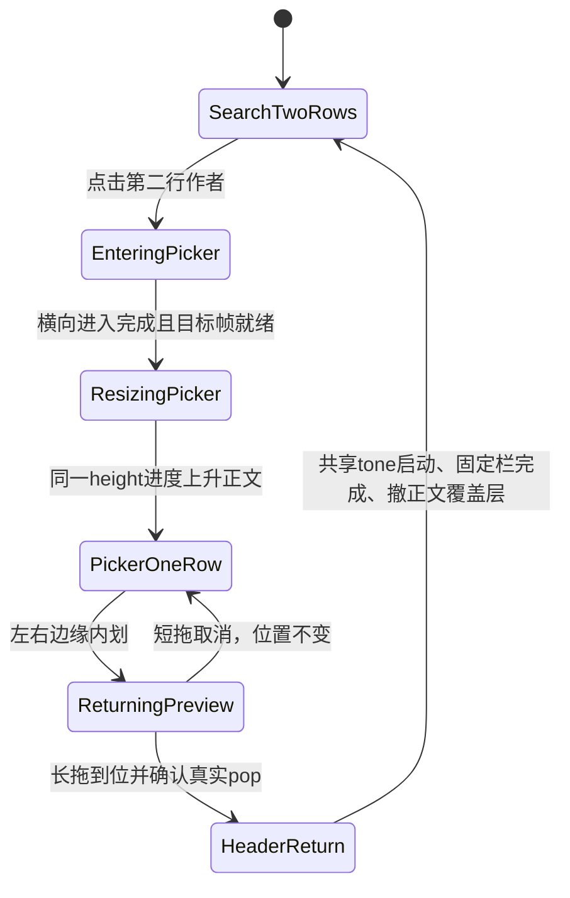

# 搜索作者选择页的正文与顶栏交接

用户截图确认路径为作品搜索第二行「作者」进入选择作者页，以及从该子页边缘返回搜索。不是左上作品／作者模式切换。截图中的旧搜索第二行控件和作者输入栏重叠，原有单／双行高度测试没有覆盖这条导航路径。

## 状态与位置

去程：顶部目标先使用来源正文留空，横向到位后才随固定栏下沿收缩而上升。内容计划绑定目标contentOwner，仅更新几何值变化，holding期接受最终测量，resize期冻结；源页面不消费该计划。中段目标保留自己的视口。

自定义边缘返回：已经露出的搜索正文缓存保留自己的原始坐标，真实目标也保留同一留空，不强行改成来源高度。这样撤缓存时不会先跳到临时位置再下移。固定顶栏仍按既有height进度展开，顶栏上沿和底栏不移位。缓存只显示捕获时明确body viewport内的像素，不能把目标双行顶栏透过来源单行页面的正文洞口显示出来；几何缺失时使用按目标角色／颜色解析的纯色surface。

返回完成：导航receipt仍只由实际pop确认。HeaderHandoff现有真实frame barrier之后才准备目标正文并启动同一tone clock，避免header与body互等；safe-area颜色使用该clock。顶栏完成真实交接后再撤promoted正文。取消、scene／account失效及目标准备失败均终结视觉receipt，不回滚已提交导航。真实控件在整个native handoff期间保持隐藏与不可点击。

## 验证状态

静音模拟器，禁止自动播放。新增回归覆盖进入、左右两侧短拖取消和完成返回；原模式切换及作者页中间切栏／边缘返回作为相邻回归。录屏需要核对输入栏真实位置与缓存交接，最终高度通过不能代替中间帧验证。

r1在编译阶段发现共享tone启动循环等待，主动停止，未运行／未计通过。r2因两个类型检查错误编译失败（RenderFrameBoundary参数标签、非optional destination绑定），均已修正。

r3相邻模式／作者页返回通过；新路径停在普通标题栏与compact搜索栏的AX wrapper顶坐标比较。它们有不同框外留白，不能将66/70当渲染surface的移动；改为真实window sampler的topMin/topMax，并保留录像核验，未仅放宽容差。

r4四项行为检查通过，新路径实际执行进入、左右短拖取消、左右完整返回。连续抽帧确认先横向到位再上升、原缓存第二行泄露已消失，但右返回终结3个采样帧出现空栏。因此r4没有通过视觉验收。

r5增加真实live controls渲染确认，四项行为检查通过，原空栏仍存在。继续追踪发现body overlay的纯色toneHeaderBand仍覆盖目标header区域：Native pinned先撤后，body还要等两个frame barrier，才一起退场。它与实际录像的空白窗口对应。单纯等待live controls并不能解决另一个overlay的遮挡。

r6补齐readiness的owner/window/contentOwner绑定，以及detach、disappear、SwiftUI dismantle、新目标probe替换、bounds改变的失败终结；三项通过含身份失效与搜索会话状态。失效终结与正常空栏作为两个问题分别验证，不把本轮作为空栏修复证明。

r7改为原子收尾：真实body已stage、真实controls已解除隐藏并经过frame fence后，在一个禁用隐式actions的CATransaction内撤Native pinned和body/toneBand，最后释放lease。没有追加横滑、独立clock或固定延时。新路径、搜索状态、视频详情返回通过。原白色搜索栏ROI（logical x12..390,y65..155，灰度<225像素）按30fps重新采样：r4出现3个近空样本、r5出现2个、r7未出现近空样本且最少485个前景像素。该统计只验证特定空栏症状，不能当App FPS或整体性能证据。原片和独立抽帧仍需核对。

r7身份注入用例未触发，失败信息为Identity actually changes。新atomic路径跳过了旧reveal的handoff诊断phase，因此QA没有执行身份变化；不能把它记为实际取消通过，也不能直接断言产品身份取消失败。r8将handoff phase移到实际目标准备完成、共享tone启动前，恢复原注入并在回调后复验token；补齐终结viewport四分量校验，以及新路径cancelled/completed终态断言。r8运行中。

尚未安装手机或发布。性能167的首次切页停顿继续保持未收敛，不用本次动画/遮挡修复代替性能结论。

## r8 完成记录及后续回归

r8两项通过：作者选择器进入与双侧边缘完成/取消、holding/handoff身份失效。完整source-before与source-after相同（manifest见`build/search168-r8.log`）。实际渲染顶栏topMin=topMax=70，8个中间样本均有输入锁；成功返回navigationOutcome=committed、visual=completed、postGlobalBlocked=false。AX单行标题wrapper与搜索wrapper的4pt差异不是渲染顶栏位移。

独立审核按真实视频PTS检查r8双侧返回收尾，没有原r4/r5的空白顶栏样本。VFR录像不能用单独-ss跳转帧认作目标时刻，需完整解码并按实际阶段校对。r7详情录像亦未见白边或二次水平移动。169r2再次运行作者路径通过；这不等于整体滑动卡顿通过。
